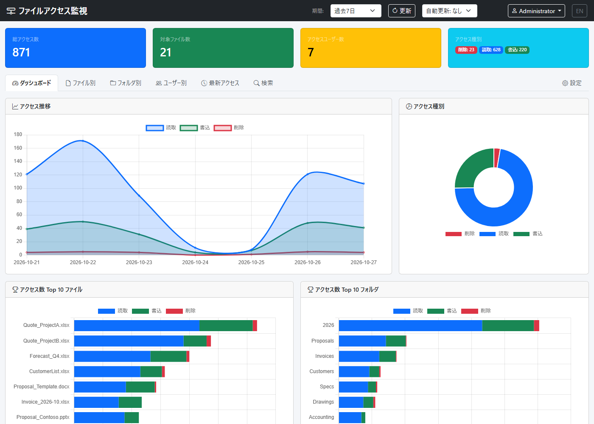
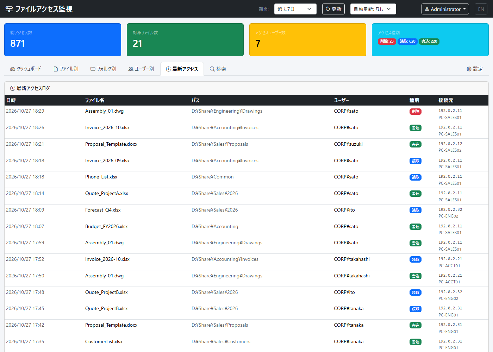
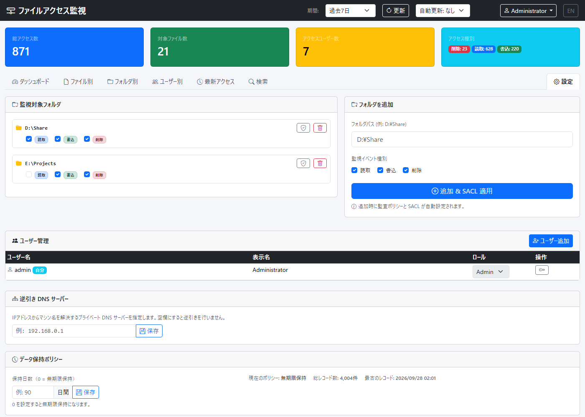

# FileAccessMonitor

[English](README.md) | 日本語

Windows ファイルサーバーの共有フォルダへのアクセス（読取・書込・削除）を Windows のセキュリティ監査ログから収集・集計し、Web GUI で可視化するツールです。



> [!IMPORTANT]
> 本ツールは「誰が・いつ・どのファイルにアクセスしたか」を記録します。組織で利用する場合は、就業規則やプライバシーポリシー等に基づき、監視対象となる利用者へ事前に周知してください。

## 必要環境

- Windows Server 2016 以降（または Windows 10/11）。監視対象の共有フォルダがあるサーバー上で動作させます
- .NET 10 SDK（ビルド時のみ）。自己完結型で発行するため、サーバー側に .NET ランタイムは不要です
- 管理者権限（セキュリティログの読み取りと SACL 設定に必要）

## セットアップ

### インストーラーで導入する（推奨）

[Releases](https://github.com/nuts-i77/FileAccessMonitor/releases) から `FileAccessMonitor-Setup-<バージョン>.exe` をダウンロードし、ファイルサーバー上で実行します。インストーラーは次の処理を行います。

- `C:\Program Files\FileAccessMonitor` にインストール
- Windows サービス `FileAccessMonitor` を登録して起動
- Web GUI のポートを指定（既定値は 8080）。必要ならファイアウォール規則も追加

新しいバージョンのインストーラーを実行すると、設定を引き継いだまま上書き更新します。インストール後は [3. 初回ログイン](#3-初回ログイン) に進んでください。

> [!NOTE]
> インストーラーはコード署名していないため、Windows SmartScreen の警告が表示されることがあります。**詳細情報** → **実行** で続行してください。ダウンロードしたファイルが正しいか確かめるには、`Get-FileHash <ファイル>` で求めたハッシュ値を、リリースページの `SHA256SUMS.txt` と照合してください。

ソースからビルドする場合は、以下の 1・2 の手順を行います。

### 1. ビルド（開発 PC）

```powershell
.\build.ps1
```

`publish\` フォルダに自己完結型の EXE が出力されます。

### 2. サービスのインストール（サーバー上、管理者 PowerShell）

`publish\` と `install-service.ps1` をサーバーへコピーして実行します。

```powershell
.\install-service.ps1
```

- `FileAccessMonitor` という名前の Windows サービスとして登録・自動起動
- TCP 8080 のファイアウォール受信規則を追加

WinRM が使える環境では、開発 PC からビルドとデプロイを一度に行えます。

```powershell
.\deploy-remote.ps1 -ServerIP <サーバー名または IP>
```

### 3. 初回ログイン

ブラウザで `http://<サーバー>:8080` を開きます。

- ユーザー名: `admin`
- パスワード: 初回起動時にランダム生成され、サーバーの以下のファイルに保存されます（SYSTEM / Administrators のみ読み取り可）

  ```
  C:\ProgramData\FileAccessMonitor\initial-admin-password.txt
  ```

ログイン後、画面右上のユーザーメニュー → **パスワード変更** で変更してください。変更するとこのファイルは自動的に削除されます。

### 4. 監視フォルダの追加

**設定** タブで監視するフォルダ（例: `D:\Share`）を追加します。追加時に監査ポリシー「ファイル システム」の有効化と、指定フォルダ配下への SACL（監査エントリ）の設定が自動で行われます。接続元 IP の取得に使う監査ポリシー「ファイルの共有」は、サービス起動時に自動で有効化されます。

監査設定をスクリプトで行う場合は `setup-audit.ps1 -SharePaths "D:\Share"` を、元に戻す場合は `restore-audit.ps1 -SharePaths "D:\Share"` を使います。

### 5. Security ログのサイズを拡張する（推奨）

Windows の Security ログは既定で 20MB 程度しかなく、アクセスの多い環境では数時間で古いイベントが上書きされます。本ツールはリアルタイムで収集するため記録自体は残りますが、調査時に元イベントを確認できるよう拡張を推奨します。

```powershell
wevtutil sl Security /ms:1073741824   # 1GB
```

## セキュリティ

- **JWT 署名鍵**: 初回起動時にランダム生成し `C:\ProgramData\FileAccessMonitor\jwt.key`（SYSTEM / Administrators のみ読み取り可）に保存します。`appsettings.json` に 32 バイト以上の `Jwt:Key` を設定した場合はそちらを使用します
- **ログイン試行制限**: 5 回連続で失敗すると、そのアカウントは 15 分間ロックされます
- **ログイン状態**: ログインは `Jwt:ExpiresHours`（既定 24 時間）有効ですが、ユーザーの削除・ロール変更・パスワード変更／リセットを行うと、その時点で無効になります
- **操作ログ**: ログイン（失敗を含む）、ユーザー管理、設定変更、CSV 出力、通知の送信を記録し、**設定 → 操作ログ** に表示します（Admin のみ）
- **通知の秘密情報**: Webhook URL と SMTP パスワードは暗号化して保存します（ASP.NET Core Data Protection、鍵はマシンの DPAPI で保護し `C:\ProgramData\FileAccessMonitor\keys\` に保存）
- **通信の暗号化**: 既定は HTTP です。社内 LAN 外からアクセスさせる場合や、パスワードを平文で流したくない場合は、`Kestrel.Endpoints` に HTTPS エンドポイントと証明書を設定するか、リバースプロキシ（IIS・nginx・Caddy 等）経由で HTTPS 化してください。設定例は [docs/https.ja.md](docs/https.ja.md) を参照してください
- **ロール**: `Admin`（設定・ユーザー管理可）と `Viewer`（閲覧のみ）

脆弱性を見つけた場合は、公開 Issue ではなく [SECURITY.md](SECURITY.md) の手順（非公開報告）でご連絡ください。

## 設定

### appsettings.json（`publish\` 内）

| 設定項目 | 説明 | 既定値 |
|---|---|---|
| `Kestrel.Endpoints.Http.Url` | 待ち受け URL | `http://0.0.0.0:8080` |
| `Jwt:ExpiresHours` | ログインの有効期間（時間） | `24` |
| `Jwt:Key` | JWT 署名鍵（通常は指定不要。上記参照） | 自動生成 |
| `ExcludeSystemAccounts` | SYSTEM やコンピューターアカウント（`xxx$`）のアクセスを除外 | `true` |
| `ExcludeProcessNames` | 除外するプロセス名 | `System`, `svchost.exe`, `SearchIndexer.exe` |

インストーラーで導入した場合、`appsettings.json` は `C:\Program Files\FileAccessMonitor\` にあり、更新時に上書きされます。独自の設定は同じフォルダの `appsettings.Production.json` に書いてください。このファイルはインストーラーが指定ポートで作成し、更新時も内容が保持されます。

### 実行時の設定・データ（`C:\ProgramData\FileAccessMonitor\`）

| ファイル | 内容 |
|---|---|
| `settings.json` | 監視フォルダ・記録するイベント種別・逆引き DNS サーバー・保持期間・通知設定（GUI から変更） |
| `fileaccess.db` | アクセス記録（SQLite） |
| `logs\app-YYYYMMDD.log` | アプリケーションログ（14 日保持） |
| `jwt.key` | JWT 署名鍵 |

## Web GUI

| タブ | 内容 |
|---|---|
| ダッシュボード | アクセス推移グラフ、種別内訳、上位ファイル／フォルダ |
| ファイル別 / フォルダ別 / ユーザー別 | ランキングと詳細ダイアログ |
| 最新アクセス | アクセスログ（接続元 IP・端末名付き） |
| 検索 | キーワード・期間・種別・IP による横断検索。結果を CSV で出力（最大 20 万件、Excel で開けます） |
| 設定 | 監視フォルダ、ユーザー管理、逆引き DNS、データ保持期間、通知、操作ログ |

日本語 / 英語に対応しています（画面右上で切り替え。初回はブラウザの言語設定に従います）。API が返すエラーメッセージも選択中の言語になります。

**最新アクセス** — 誰が・どの端末（IP アドレス）から・どのファイルにアクセスしたか:



**設定** — 監視フォルダと記録するアクセス種別、ユーザー管理、逆引き DNS、データ保持期間:



スクリーンショットは架空のサンプルデータです。

## 仕組み

1. Windows セキュリティイベントログ（4663 / 4659）をリアルタイムに購読
2. ログオン（4624）・共有アクセス（5140）イベントと SMB セッション一覧から接続元 IP / 端末名を補完
3. SQLite に記録し、ASP.NET Core の Web API で集計
4. ブラウザ（Bootstrap + Chart.js）で表示

### アクセス種別の判定（AccessMask）

| 種別 | Mask 値 |
|---|---|
| 読取 (Read) | `0x1` (ReadData) / `0x80000000` (GENERIC_READ) |
| 書込 (Write) | `0x2` (WriteData) / `0x4` (AppendData) / `0x40000000` (GENERIC_WRITE) |
| 削除 (Delete) | `0x10000` (DELETE)、およびイベント 4659 |

## 制限事項

- **ファイルを開かない操作は記録されません。** 属性・更新日時の参照のみ（`0x80` ReadAttributes など）やフォルダの一覧表示は対象外です。たとえば差分バックアップツールが「変更なし」と判定してコピーしなかったファイルは記録されません
- サービス停止中（更新や再起動など）に発生したアクセスは、Security ログに残っていれば次の起動時に記録します。すでに上書きされていた場合は、欠落したことを操作ログに記録します
- サービスは監視対象のファイルサーバー上で動作させる必要があります（リモートのサーバーは監視できません）
- 時刻は UTC で保存し、画面ではブラウザのタイムゾーンで表示・日別集計します

## 開発

```powershell
dotnet build FileAccessMonitor.csproj
dotnet test tests/FileAccessMonitor.Tests
```

インストーラーを手元で作る場合は、[Inno Setup 6](https://jrsoftware.org/isinfo.php) をインストールしてから `.\build-installer.ps1 -Version 1.0.0` を実行します。`dist\` に出力されます。

GitHub Actions（`.github/workflows/ci.yml`）で push / Pull Request ごとにビルド・テスト・発行を実行します。`v1.0.0` のようなタグを push すると、`.github/workflows/release.yml` がインストーラーと zip 版を作成し、GitHub Releases に公開します。

## アンインストール

インストーラーで導入した場合は、**設定 → アプリ** から **File Access Monitor** をアンインストールします。サービスとファイアウォール規則は削除されます。アクセス記録・設定・鍵は `C:\ProgramData\FileAccessMonitor\` に残るので、不要であればそのフォルダを削除してください。監査エントリ (SACL) も削除する場合は、アンインストールの前に `C:\Program Files\FileAccessMonitor\scripts\restore-audit.ps1` を実行してください。

ソースから導入した場合:

```powershell
.\install-service.ps1 -Uninstall
.\restore-audit.ps1 -SharePaths "D:\Share"   # 監査設定を元に戻す場合
```

## ライセンス

[MIT License](LICENSE)

同梱しているサードパーティライブラリ（`wwwroot/lib/`）:

| ライブラリ | バージョン | ライセンス |
|---|---|---|
| [Bootstrap](https://getbootstrap.com/) | 5.3.3 | MIT |
| [Bootstrap Icons](https://icons.getbootstrap.com/) | 1.11.3 | MIT |
| [Chart.js](https://www.chartjs.org/) | 4.4.4 | MIT |

各ライセンス文は `wwwroot/lib/` 配下の各フォルダにあります。
