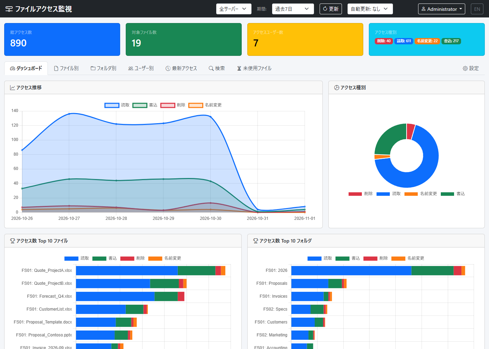

# FileAccessMonitor

[English](README.md) | 日本語

ファイルサーバーの共有フォルダへのアクセス（読み取り・書き込み・作成・削除・名前変更・権限変更、および拒否された試み）を記録・集計し、Web GUI で可視化するツールです。Windows のファイルサーバーはセキュリティ監査ログから、Samba で共有している Linux のファイルサーバーは Samba の監査ログから収集します。複数のファイルサーバーの記録を、エージェントで 1 台の監視サーバーに集められます。監視サーバーは Windows でも Linux でも動きます。



> [!IMPORTANT]
> 本ツールは「誰が・いつ・どのファイルにアクセスしたか」を記録します。組織で利用する場合は、就業規則やプライバシーポリシー等に基づき、監視対象となる利用者へ事前に周知してください。

## 構成と必要環境

FileAccessMonitor は次の 2 つの役割で動きます。

- **監視サーバー**: Web 画面・データベース・通知を持ち、記録を集めて表示します。自分自身の共有フォルダのアクセスも記録する（**1 台構成**）か、エージェントから届いた記録だけを表示する（**監視サーバーのみ**）かを選べます
- **エージェント**: 監視したいファイルサーバーに入れ、そのサーバーのアクセスを記録して監視サーバーに送ります。Web 画面はありません

ファイルサーバーが 1 台なら、そのサーバーに監視サーバー（1 台構成）を入れるだけで使えます。2 台目以降のファイルサーバーにはエージェントを入れます。

| | 監視サーバー（Windows） | 監視サーバー（Linux） | エージェント（Windows） | エージェント（Linux） |
|---|---|---|---|---|
| OS | Windows Server 2016 以降、Windows 10/11 | systemd が動く x86-64 の Linux（Rocky Linux 9.4 で確認） | Windows Server 2016 以降、Windows 10/11 | systemd が動く x86-64 の Linux（Ubuntu 24.04、Rocky Linux 9.4 で確認） |
| 記録する対象 | 1 台構成の場合: このサーバーの NTFS・ReFS ドライブ上の共有フォルダ（Windows の監査ログ） | `--collect` の場合: このサーバーの Samba 共有 | このサーバーの NTFS・ReFS ドライブ上の共有フォルダ（Windows の監査ログ） | Samba 4.x の共有（SMB 経由のアクセス） |
| 権限 | 導入に管理者権限（Web GUI のサービスは権限なしで動作。ローカル収集では 2 つ目のサービス「コレクター」が SYSTEM で動作） | 導入に root（Web GUI は専用ユーザーで動作。`--collect` では 2 つ目のサービス「コレクター」が root で動作） | 導入に管理者権限（SYSTEM で動作） | root |
| ネットワーク | 受信: TCP 8080（Web 画面）、8443（エージェント） | 受信: TCP 8080、8443 | 送信: 監視サーバーの 8443 のみ | 送信: 監視サーバーの 8443 のみ |
| 配布ファイル | `FileAccessMonitor-Setup-<版>.exe` | `fileaccessmonitor-server` の rpm / deb（または tar.gz） | `FileAccessMonitor-Setup-<版>.exe`（役割で「エージェント」を選択） | `fileaccessmonitor-agent` の rpm / deb（または tar.gz） |
| 手順 | [インストーラーで導入する](#インストーラーで導入する推奨) | [Linux の監視サーバー](https://github.com/nuts-i77/FileAccessMonitor/blob/main/docs/linux-server.ja.md) | [複数のファイルサーバーから収集する](https://github.com/nuts-i77/FileAccessMonitor/blob/main/docs/agents.ja.md) | [Linux のファイルサーバー](https://github.com/nuts-i77/FileAccessMonitor/blob/main/docs/agents.ja.md#linux-のファイルサーバーsamba-エージェント) |

- どれも自己完結型で配布するため、.NET ランタイムのインストールは不要です（ソースからビルドする場合のみ .NET 10 SDK が必要）
- Web 画面は、監視サーバーにつながる PC のブラウザ（Edge、Chrome、Firefox など）で使います
- エージェントから監視サーバーへの接続だけを使い、監視サーバーからファイルサーバーへは接続しません

## セットアップ

### インストーラーで導入する（推奨）

[Releases](https://github.com/nuts-i77/FileAccessMonitor/releases) から `FileAccessMonitor-Setup-<バージョン>.exe` をダウンロードし、Windows のファイルサーバー（監視サーバーを別のマシンにする場合はそのマシン）で実行します。インストーラーは次の処理を行います。

- `C:\Program Files\FileAccessMonitor` にインストール
- Windows サービスを登録して起動: `FileAccessMonitor`（Web GUI とデータベース。仮想サービスアカウント `NT SERVICE\FileAccessMonitor` で、権限なしで動作）と、監視サーバーのみを選んだ場合を除き `FileAccessMonitorCollector`（「File Access Monitor Collector」。SYSTEM で動作し、アクセスの記録と監査の設定を担当）。エージェントの導入では、サービスは `FileAccessMonitor`（SYSTEM）のみです。詳しくは[どのアカウントが何を実行するか](https://github.com/nuts-i77/FileAccessMonitor/blob/main/docs/security.ja.md#どのアカウントが何を実行するか)を参照してください
- サーバーの使い方を選択: **1 台構成 / 監視サーバー**（このサーバーのアクセスを記録し、Web GUI を表示）、**監視サーバーのみ**（Web GUI を表示し[エージェント](https://github.com/nuts-i77/FileAccessMonitor/blob/main/docs/agents.ja.md)から記録を受け取る。このサーバー自身のアクセスは記録せず、監査の設定も変更しない）、**エージェント**
- Web GUI のポートを指定（既定値は 8080）。必要なら FileAccessMonitor.exe の受信を許可するファイアウォール規則も追加（Web GUI のポートとエージェント用ポート 8443）

新しいバージョンのインストーラーを実行すると、設定を引き継いだまま上書き更新します。インストール後は [初回ログイン](#初回ログイン) に進んでください。

初回ログインのあと、**導入ウィザード**が開きます。admin のパスワードの変更、ファイルサーバーの選択（エージェントがあるとき）、最初の監視フォルダの追加、Security ログのサイズの拡張（Windows。推奨は 1 GB）、最初の記録が届くことの確認を、順に行います。［あとで］で閉じても、**設定** タブの［導入ウィザード］からいつでも開けます。以下の節は、ウィザードが行う内容の説明です。

> [!NOTE]
> インストーラーはコード署名していないため、Windows SmartScreen の警告が表示されることがあります。**詳細情報** → **実行** で続行してください。ダウンロードしたファイルが正しいかを確認する方法は「[ダウンロードしたファイルの検証](https://github.com/nuts-i77/FileAccessMonitor/blob/main/docs/install.ja.md#ダウンロードしたファイルの検証)」を参照してください。

ソースからビルドする場合は、[インストールの詳細](https://github.com/nuts-i77/FileAccessMonitor/blob/main/docs/install.ja.md) を参照してください。

### 初回ログイン

ブラウザで `https://<サーバー>:8080` を開きます（新規インストールは自己署名証明書の HTTPS なので、ブラウザーに警告が一度表示されます。1.9 より前から更新した環境は、切り替えるまで `http://` のままです。[通信の暗号化](https://github.com/nuts-i77/FileAccessMonitor/blob/main/docs/security.ja.md)を参照）。

- ユーザー名: `admin`
- パスワード: 初回起動時にランダム生成され、サーバーの以下のファイルに保存されます（SYSTEM / Administrators と Web GUI のサービスアカウントのみ読み取り可）

  ```
  C:\ProgramData\FileAccessMonitor\initial-admin-password.txt
  ```

ログイン後、画面右上のユーザーメニュー → **パスワード変更** で変更してください。変更するとこのファイルは自動的に削除されます。

### 監視フォルダの追加

**設定** タブで監視するフォルダ（例: `D:\Share`）を追加します。追加時に、監査ポリシー「ファイル システム」（成功と失敗）、「ハンドル操作」（失敗のみ。これがないと拒否された操作はログに残りません）、「承認ポリシーの変更」（成功。権限変更用）の有効化と、指定フォルダ配下への SACL（監査エントリ。成功と拒否の読み取り・書き込み・削除、権限と所有者の変更が対象）の設定が自動で行われます。接続元 IP の取得に使う監査ポリシー「ファイルの共有」は、サービス起動時に自動で有効化されます。

1.9 より前から更新した場合は、すでにある監視フォルダごとに **SACL 再適用** を 1 回押してください（Linux の共有でも同じボタンで Samba の監査を設定し直します）。押すまでは、拒否されたアクセスと権限変更は記録されません。まだ必要なフォルダは設定画面に表示されます。

監査設定をスクリプトで行う場合は `setup-audit.ps1 -SharePaths "D:\Share"` を、元に戻す場合は `restore-audit.ps1 -SharePaths "D:\Share"`$1
Windows では、作成と名前変更後の名前を記録する [USN ジャーナル](https://github.com/nuts-i77/FileAccessMonitor/blob/main/docs/install.ja.md#windows-での作成と名前変更usn-ジャーナル) と、[Security ログのサイズの拡張](https://github.com/nuts-i77/FileAccessMonitor/blob/main/docs/install.ja.md#security-ログのサイズを拡張する推奨) も参照してください。

## ドキュメント

| 内容 | 説明 |
|---|---|
| [インストールの詳細](https://github.com/nuts-i77/FileAccessMonitor/blob/main/docs/install.ja.md) | ソースからのビルド、スクリプトでのサービス登録、USN ジャーナル、Security ログのサイズ、ダウンロードしたファイルの検証、開発 |
| [エージェント](https://github.com/nuts-i77/FileAccessMonitor/blob/main/docs/agents.ja.md) | 複数の Windows と Linux（Samba）のファイルサーバーからの収集 |
| [Linux の監視サーバー](https://github.com/nuts-i77/FileAccessMonitor/blob/main/docs/linux-server.ja.md) | 監視サーバーを Linux で動かす |
| [Web GUI](https://github.com/nuts-i77/FileAccessMonitor/blob/main/docs/gui.ja.md) | 各タブ、通知、定期レポート、ファイルの履歴、アクセス権のレポート |
| [セキュリティ](https://github.com/nuts-i77/FileAccessMonitor/blob/main/docs/security.ja.md) | ログイン、ロール、閲覧範囲、操作ログ、改ざん検知、どのアカウントが何を実行するか |
| [設定](https://github.com/nuts-i77/FileAccessMonitor/blob/main/docs/configuration.ja.md) | appsettings.json、実行時の設定とデータフォルダ |
| [仕組み](https://github.com/nuts-i77/FileAccessMonitor/blob/main/docs/how-it-works.ja.md) | 収集の流れ、アクセス種別の判定、記録ルール、制限事項 |
| [他のツールとの比較](https://github.com/nuts-i77/FileAccessMonitor/blob/main/docs/comparison.ja.md) | このツールとほかの選択肢の使い分け |
| [バックアップと復元](https://github.com/nuts-i77/FileAccessMonitor/blob/main/docs/backup.ja.md) | 毎日・コマンドでのデータフォルダのバックアップ、復元、更新に失敗したときの戻し方 |
| [アンインストール](https://github.com/nuts-i77/FileAccessMonitor/blob/main/docs/uninstall.ja.md) | プログラムと監査設定の削除 |
| [HTTPS](https://github.com/nuts-i77/FileAccessMonitor/blob/main/docs/https.ja.md) | Web GUI の HTTPS の詳細 |
| [改ざん検知](https://github.com/nuts-i77/FileAccessMonitor/blob/main/docs/integrity.ja.md) | 改ざん検知の仕組みと運用 |

## 制限事項

[仕組み](https://github.com/nuts-i77/FileAccessMonitor/blob/main/docs/how-it-works.ja.md) の [制限事項](https://github.com/nuts-i77/FileAccessMonitor/blob/main/docs/how-it-works.ja.md#制限事項) を参照してください（1.13 で移動しました）。

## プライバシーポリシー

本プログラムは、利用者またはインストール・運用する人が明示的に指定しない限り、他のネットワーク上のシステムに情報を送信しません。外部に送信するのは、管理者が設定した場合だけです。具体的には、設定タブで指定した Webhook URL・メールサーバーへの通知と、同じく設定タブで指定した DNS サーバーへの接続元 IP アドレスの逆引きです。エージェントは、登録した監視サーバーにアクセス記録を送信します。

更新の確認: 管理者が Web 画面を開いたとき、1 日 1 回まで、管理者のブラウザが GitHub API（`api.github.com`）にこのプロジェクトの最新リリースを問い合わせます。通常の Web アクセスと同様に、ブラウザの IP アドレスとユーザーエージェントが GitHub に伝わります。ファイルサーバーや記録の内容は送信せず、ファイルサーバー自体も外部と通信しません。**設定 → アプリと接続** で無効にできます。

## ライセンス

[MIT License](LICENSE)

同梱しているサードパーティライブラリ（`wwwroot/lib/`）:

| ライブラリ | バージョン | ライセンス |
|---|---|---|
| [Bootstrap](https://getbootstrap.com/) | 5.3.3 | MIT |
| [Bootstrap Icons](https://icons.getbootstrap.com/) | 1.11.3 | MIT |
| [Chart.js](https://www.chartjs.org/) | 4.4.4 | MIT |

各ライセンス文は `wwwroot/lib/` 配下の各フォルダにあります。
