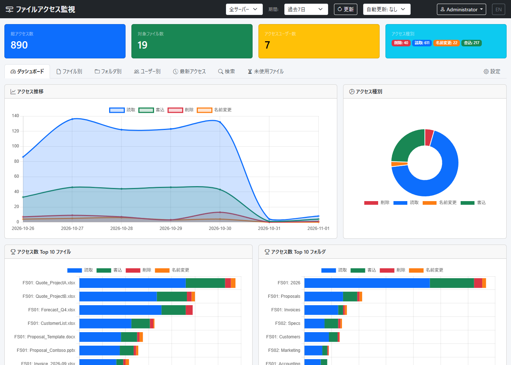
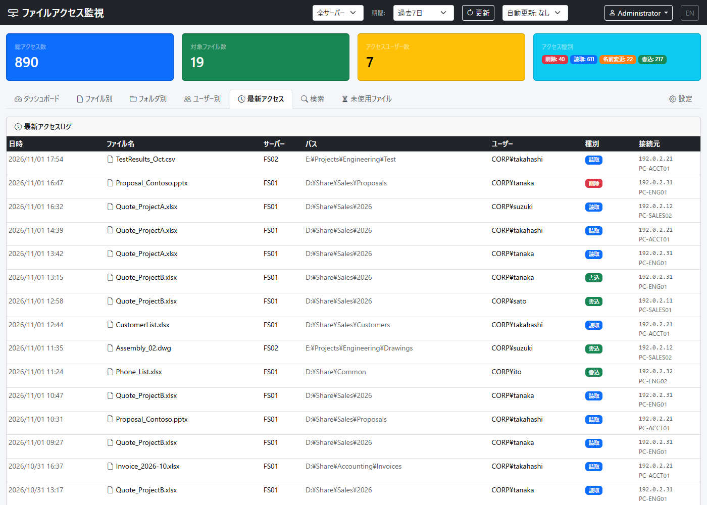
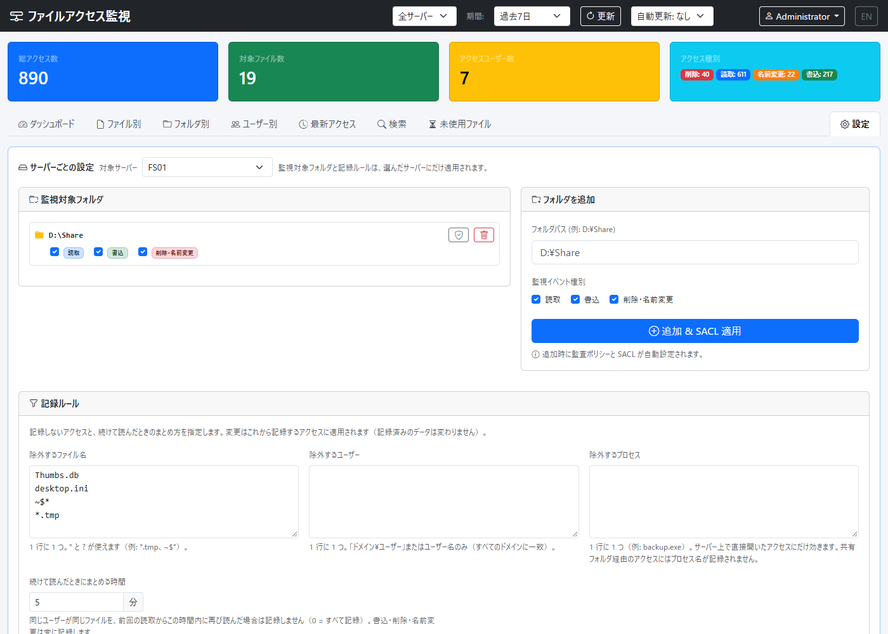

# FileAccessMonitor

[English](README.md) | 日本語

Windows ファイルサーバーの共有フォルダへのアクセス（読取・書込・削除）を Windows のセキュリティ監査ログから収集・集計し、Web GUI で可視化するツールです。



> [!IMPORTANT]
> 本ツールは「誰が・いつ・どのファイルにアクセスしたか」を記録します。組織で利用する場合は、就業規則やプライバシーポリシー等に基づき、監視対象となる利用者へ事前に周知してください。

## 必要環境

- Windows Server 2016 以降（または Windows 10/11）。監視対象の共有フォルダがあるサーバー上で動作させます
- .NET 10 SDK（ビルド時のみ）。自己完結型で発行するため、サーバー側に .NET ランタイムは不要です
- 管理者権限（セキュリティログの読み取りと SACL 設定に必要）

## セットアップ

### インストーラーで導入する（推奨）

[Releases](https://github.com/nuts-i77/FileAccessMonitor/releases) から `FileAccessMonitor-Setup-<バージョン>.exe` をダウンロードし、ファイルサーバー上で実行します。インストーラーは次の処理を行います。

- `C:\Program Files\FileAccessMonitor` にインストール
- Windows サービス `FileAccessMonitor` を登録して起動
- Web GUI のポートを指定（既定値は 8080）。必要なら FileAccessMonitor.exe の受信を許可するファイアウォール規則も追加（Web GUI のポートとエージェント用ポート 8443）

新しいバージョンのインストーラーを実行すると、設定を引き継いだまま上書き更新します。インストール後は [3. 初回ログイン](#3-初回ログイン) に進んでください。

> [!NOTE]
> インストーラーはコード署名していないため、Windows SmartScreen の警告が表示されることがあります。**詳細情報** → **実行** で続行してください。ダウンロードしたファイルが正しいか確かめる方法は「[ダウンロードしたファイルの検証](#ダウンロードしたファイルの検証)」を参照してください。

ソースからビルドする場合は、以下の 1・2 の手順を行います。

### 1. ビルド（開発 PC）

```powershell
.\build.ps1
```

`publish\` フォルダに自己完結型の EXE が出力されます。

### 2. サービスのインストール（サーバー上、管理者 PowerShell）

`publish\` と `install-service.ps1` をサーバーへコピーして実行します。

```powershell
.\install-service.ps1
```

- `FileAccessMonitor` という名前の Windows サービスとして登録・自動起動
- FileAccessMonitor.exe のファイアウォール受信規則を追加（TCP 8080、エージェント用の 8443）

WinRM が使える環境では、開発 PC からビルドとデプロイを一度に行えます。

```powershell
.\deploy-remote.ps1 -ServerIP <サーバー名または IP>
```

### 3. 初回ログイン

ブラウザで `http://<サーバー>:8080` を開きます。

- ユーザー名: `admin`
- パスワード: 初回起動時にランダム生成され、サーバーの以下のファイルに保存されます（SYSTEM / Administrators のみ読み取り可）

  ```
  C:\ProgramData\FileAccessMonitor\initial-admin-password.txt
  ```

ログイン後、画面右上のユーザーメニュー → **パスワード変更** で変更してください。変更するとこのファイルは自動的に削除されます。

### 4. 監視フォルダの追加

**設定** タブで監視するフォルダ（例: `D:\Share`）を追加します。追加時に監査ポリシー「ファイル システム」の有効化と、指定フォルダ配下への SACL（監査エントリ）の設定が自動で行われます。接続元 IP の取得に使う監査ポリシー「ファイルの共有」は、サービス起動時に自動で有効化されます。

監査設定をスクリプトで行う場合は `setup-audit.ps1 -SharePaths "D:\Share"` を、元に戻す場合は `restore-audit.ps1 -SharePaths "D:\Share"` を使います。

### 5. Security ログのサイズを拡張する（推奨）

Windows の Security ログは既定で 20MB 程度しかなく、アクセスの多い環境では数時間で古いイベントが上書きされます。本ツールはリアルタイムで収集するため記録自体は残りますが、調査時に元イベントを確認できるよう拡張を推奨します。

```powershell
wevtutil sl Security /ms:1073741824   # 1GB
```

### 6. 複数のファイルサーバーから収集する（エージェント）

1 つの画面で、複数のファイルサーバーの記録を見られます。Web GUI を表示するサーバー（監視サーバー）には通常どおりインストールし、他のファイルサーバーには **エージェント** としてインストールします（収集と送信のみを行います）。

1. ファイルサーバーから監視サーバーの TCP **8443**（エージェント用ポート）に接続できるようにします。監視サーバーは常にこのポートで待ち受けており、インストーラーのファイアウォールのオプションで許可できます。この規則は FileAccessMonitor.exe を許可するので、Web GUI のポートとエージェント用ポートの両方が対象です
2. **設定 → エージェント** で **登録コードを発行** を押します。ファイルサーバーから監視サーバーへ別の名前や IP アドレスで接続する場合は、アドレスを変更して **反映** を押します。表示された接続文字列をコピーします（24 時間有効、1 回だけ使えます）
3. ファイルサーバーでインストーラーを実行し、**エージェント** を選んで接続文字列を貼り付けます。インストール済みのサーバーをエージェントにする場合は、管理者の PowerShell で次を実行します

   ```powershell
   & "C:\Program Files\FileAccessMonitor\FileAccessMonitor.exe" enroll <接続文字列>
   Restart-Service FileAccessMonitor
   ```
4. ファイルサーバーの管理者 PowerShell で次を実行し、共有フォルダの監査を設定します。`-ExecutionPolicy Bypass` を付けると、スクリプトの実行が無効な環境でもこのスクリプトだけを実行できます

   ```powershell
   powershell -ExecutionPolicy Bypass -File "C:\Program Files\FileAccessMonitor\scripts\setup-audit.ps1" -SharePaths "D:\Share"
   ```

仕組みと制限:

- 接続は常にエージェントから監視サーバーに向かいます（監視サーバーからファイルサーバーへは接続しません）。通信は HTTPS で、証明書は監視サーバーが自動で作成します。エージェントはその証明書だけを信頼する（指紋を接続文字列に含めています）ため、認証局は不要です
- 記録は、監視サーバーが保存するまでエージェントの送信待ちフォルダ（`C:\ProgramData\FileAccessMonitor\outbox`、最大 2 GB）に残るため、監視サーバーに接続できない間も失われません
- 複数のサーバーから記録が届くと、画面上部にサーバーの絞り込みが表示され、一覧のパスにサーバー名が付きます
- 監視フォルダと記録ルールはサーバーごとに設定します（**設定** タブ上部でサーバーを選択）。エージェントは 1 分以内に変更を取り込みます。エージェントのサーバーに監視フォルダを追加すると、エージェントがフォルダの存在確認と監査エントリ（SACL）の設定を行います。**未使用ファイル** タブでは、選んだサーバーのファイルをエージェント経由で調べます。これらはエージェントが接続中である必要があります。監視フォルダを設定するまでは、エージェントはそのサーバーで監査されたすべてのアクセスを記録します
- 閲覧範囲では、フォルダごとにサーバーを指定できます（「全サーバー」はどのサーバーの同じパスも対象）
- **エージェント** の一覧には、最終接続、バージョン（監視サーバーと異なる場合は「要更新」）、送信待ちの件数、ファイルアクセスの監査が有効かを表示します。通知が有効な場合、15 分（変更可、0 で通知しない）以上接続がないエージェントを通知し、復旧したときも通知します
- アラートや通知には、アクセスが発生したファイルサーバー名が入ります
- 記録の時刻は各ファイルサーバーの時計に基づきます。サーバー間の時刻を同期してください（NTP。ドメイン参加マシンは既定で同期されます）
- `FileAccessMonitor.exe unenroll` でエージェントを 1 台構成に戻せます

エージェント用ポートを変更する手順:

1. 監視サーバーの `C:\ProgramData\FileAccessMonitor\settings.json` に次を追加します。ファイル内の他の設定は残してください

   ```json
   "Agents": { "Port": 9443 }
   ```
2. `Restart-Service FileAccessMonitor` でサービスを再起動します。インストーラーが作るファイアウォール規則はポートではなくプログラムを許可するので、変更は不要です
3. 登録済みのエージェントは古いアドレスのままです。接続文字列を発行し直し、各ファイルサーバーで `FileAccessMonitor.exe enroll <接続文字列>` を実行してサービスを再起動してください

エージェントを使わず、ポートを開けたくない場合は、代わりに `"Agents": { "Enabled": false }` を指定します。

## セキュリティ

- **JWT 署名鍵**: 初回起動時にランダム生成し `C:\ProgramData\FileAccessMonitor\jwt.key`（SYSTEM / Administrators のみ読み取り可）に保存します。`appsettings.json` に 32 バイト以上の `Jwt:Key` を設定した場合はそちらを使用します
- **ログイン試行制限**: 5 回連続で失敗すると、そのアカウントは 15 分間ロックされます
- **閲覧範囲**: 管理者は **設定 → ユーザー管理** で、Viewer が見られるフォルダを限定できます（例: 部署ごとの共有フォルダ）。そのユーザーには、CSV 出力や未使用ファイルを含め、指定したフォルダ配下の記録だけが表示されます。通知先メールアドレスを指定すると、そのフォルダでのアラートもメールで届きます。Admin と、フォルダを指定していない Viewer は全体を見られます。変更は次の操作から反映されます
- **ログイン状態**: ログインは `Jwt:ExpiresHours`（既定 24 時間）有効ですが、ユーザーの削除・ロール変更・パスワード変更／リセットを行うと、その時点で無効になります
- **操作ログ**: ログイン（失敗を含む）、ユーザー管理、設定変更、CSV 出力、通知の送信を記録し、**設定 → 操作ログ** に表示します（Admin のみ）
- **通知の秘密情報**: Webhook URL と SMTP パスワードは暗号化して保存します（ASP.NET Core Data Protection、鍵はマシンの DPAPI で保護し `C:\ProgramData\FileAccessMonitor\keys\` に保存）
- **通信の暗号化**: 既定は HTTP です。社内 LAN 外からアクセスさせる場合や、パスワードを平文で流したくない場合は、`Kestrel.Endpoints` に HTTPS エンドポイントと証明書を設定するか、リバースプロキシ（IIS・nginx・Caddy 等）経由で HTTPS 化してください。設定例は [docs/https.ja.md](docs/https.ja.md) を参照してください
- **ロール**: `Admin`（設定・ユーザー管理可）と `Viewer`（閲覧のみ）

脆弱性を見つけた場合は、公開 Issue ではなく [SECURITY.md](SECURITY.md) の手順（非公開報告）でご連絡ください。

## 設定

### appsettings.json（`publish\` 内）

| 設定項目 | 説明 | 既定値 |
|---|---|---|
| `Kestrel.Endpoints.Http.Url` | 待ち受け URL | `http://0.0.0.0:8080` |
| `Jwt:ExpiresHours` | ログインの有効期間（時間） | `24` |
| `Jwt:Key` | JWT 署名鍵（通常は指定不要。上記参照） | 自動生成 |
| `ExcludeSystemAccounts` | SYSTEM やコンピューターアカウント（`xxx$`）のアクセスを除外 | `true` |
| `ExcludeProcessNames` | 除外するプロセス名 | `System`, `svchost.exe`, `SearchIndexer.exe` |

インストーラーで導入した場合、`appsettings.json` は `C:\Program Files\FileAccessMonitor\` にあり、更新時に上書きされます。独自の設定は同じフォルダの `appsettings.Production.json` に書いてください。このファイルはインストーラーが指定ポートで作成し、更新時も内容が保持されます。

### 実行時の設定・データ（`C:\ProgramData\FileAccessMonitor\`）

| ファイル | 内容 |
|---|---|
| `settings.json` | 監視フォルダ・記録するイベント種別・逆引き DNS サーバー・保持期間・通知設定（GUI から変更） |
| `fileaccess.db` | アクセス記録（SQLite） |
| `logs\app-YYYYMMDD.log` | アプリケーションログ（14 日保持） |
| `jwt.key` | JWT 署名鍵 |

## Web GUI

| タブ | 内容 |
|---|---|
| ダッシュボード | アクセス推移グラフ、種別内訳、上位ファイル／フォルダ |
| ファイル別 / フォルダ別 / ユーザー別 | ランキングと詳細ダイアログ |
| 最新アクセス | アクセスログ（接続元 IP・端末名付き） |
| 検索 | キーワード・期間・種別・IP による横断検索。結果を CSV で出力（最大 20 万件、Excel で開けます） |
| 未使用ファイル | 監視フォルダ内で、指定期間に読まれていない（アクセスのない）ファイルとその容量を、フォルダを調べて一覧・フォルダ別に集計（Admin のみ、1 回あたり最大 10 万ファイル） |
| 設定 | 監視フォルダ、ユーザー管理、記録ルール（除外・連続した読取のまとめ）、逆引き DNS、データ保持期間、通知、操作ログ |

通知（Teams / Slack / Webhook / メール）は、1 人のユーザーが数分以内に設定件数以上のファイルを削除・書込・読取したとき（大量読取は既定でオフ）と、記録が途切れたとき（Security ログのイベントが収集前に上書きされた、またはログが消去された。消去したユーザーも通知）に送信します。インターネットへの接続にプロキシが必要な場合は、通知設定でプロキシを指定してください（Webhook のみ。サービスは SYSTEM で動くため、Windows のプロキシ設定は使われません）。

日本語 / 英語に対応しています（画面右上で切り替え。初回はブラウザの言語設定に従います）。API が返すエラーメッセージも選択中の言語になります。

**最新アクセス** — 誰が・どのファイルサーバーで・どの端末（IP アドレス）から・どのファイルにアクセスしたか:



**設定** — サーバーごとの監視フォルダと記録ルール（画像はエージェント FS01 を選択した状態）と、全体の設定:



スクリーンショットは架空のサンプルデータです。

## 仕組み

1. Windows セキュリティイベントログ（4663 / 4659 / 4660）をリアルタイムに購読
2. ログオン（4624）・共有アクセス（5140）イベントと SMB セッション一覧から接続元 IP / 端末名を補完
3. SQLite に記録し、ASP.NET Core の Web API で集計
4. ブラウザ（Bootstrap + Chart.js）で表示

### アクセス種別の判定（AccessMask）

| 種別 | Mask 値 |
|---|---|
| 読取 (Read) | `0x1` (ReadData) / `0x80000000` (GENERIC_READ) |
| 書込 (Write) | `0x2` (WriteData) / `0x4` (AppendData) / `0x40000000` (GENERIC_WRITE) |
| 削除 (Delete) | `0x10000` (DELETE) の後に同じハンドルのイベント 4660（オブジェクトの削除）、およびイベント 4659 |
| 名前変更 (Rename) | `0x10000` (DELETE) の後にイベント 4660 がない（名前変更・移動） |

名前変更や移動でもファイルは削除権限で開かれるため、削除権限のアクセスは最大 2 秒保留し、イベント 4660 で実際に削除されたかを判定します。削除されておらず、同じパスにファイルが再び存在する場合（Office は古いファイルを別名に変更し、新しいファイルを元の名前に変更して保存します）は書込として記録します。名前変更は「削除・名前変更」を選択したフォルダで記録します。

フォルダは、削除・名前変更されたときだけ記録します。画面ではフォルダアイコンで表示し、CSV にもファイルかフォルダかを出力します。ファイル別ランキングと大量削除のアラートには含めません（中のファイルの削除がすでに数えられているため）。フォルダを開いたり、中にファイルを追加したりした操作は記録しません。

### 記録ルール

管理者は **設定** タブで、除外するファイル名のパターン（`*` と `?` が使えます）・ユーザー・プロセスと、連続した読取のまとめを設定できます。同じユーザーが同じファイルを前回の読取から設定時間内（既定 5 分）に再び読んだ場合は記録しません。時間は読取のたびに数え直すため、長い動画をシークしながら見ても 1 回と数えます。既定では `Thumbs.db`、`desktop.ini`、`~$*`（Office のロックファイル）、`*.tmp` を除外します。ルールは保存後に記録するアクセスに適用されます。

## 他のツールとの比較

FileAccessMonitor の目的は、ログ基盤を構築せずに「Windows ファイルサーバーで誰がファイルを読み・変更し・削除したか」を少人数の運用で確認できるようにすることです。それ以上が必要な場合は、他のツールの方が合っている可能性があります。

| | FileAccessMonitor | 商用の監査製品<br>（例: Netwrix Auditor、ManageEngine ADAudit Plus） | Wazuh |
|---|---|---|---|
| 費用 | 無料（MIT） | 有償ライセンス | 無料（OSS）。有償のクラウド版・サポートあり |
| 導入 | ファイルサーバーにインストーラーを 1 つ実行 | インストーラー。別途サーバーやデータベースが必要な場合が多い | Wazuh サーバー・インデクサー・ダッシュボードの構築と、各ホストへのエージェント導入 |
| 対象範囲 | 1 台の Windows ファイルサーバーのファイルアクセス | ファイルサーバー、NAS、Active Directory、Microsoft 365 など | 多数のホストを対象としたセキュリティ監視（SIEM/XDR） |
| 誰がファイルを**読んだ**か | 可（Security ログのイベント 4663/4659） | 可 | ファイル整合性監視は変更のみ。読取は Security ログの収集と独自ルールが必要 |
| 複数サーバーの一元表示 | 不可（サーバーごとに 1 インスタンス・1 画面） | 可 | 可 |
| アラート | 大量削除・変更・読取と記録の途切れを Teams / Slack / Webhook / メールへ通知 | 多数の組み込みルール | 柔軟なルールと自動対応 |
| レポート | 検索と CSV 出力 | コンプライアンス向けレポート、定期レポート | ダッシュボード、コンプライアンス対応表 |
| 日本語 UI | あり | 製品による | なし |
| サポート | コミュニティ（GitHub Issues）、SLA なし | ベンダーサポート | コミュニティ、または有償サポート |

**選び方の目安**

- **FileAccessMonitor**: Windows ファイルサーバーが 1 台～数台で、「このファイルを消したのは誰か」「このフォルダを誰が開いたか」を確認したい。ログ基盤は運用したくない。
- **商用製品**: 複数サーバーや AD、Microsoft 365 をまとめて監査したい、コンプライアンス向けレポートやベンダーサポートが必要。
- **Wazuh**: 組織全体のセキュリティ監視を構築しており、ファイルアクセスはその情報源の 1 つ。

上記の各製品の機能は公開情報に基づく概要であり、変更される可能性があります。詳細は各製品のドキュメントを確認してください。

## 制限事項

- **ファイルを開かない操作は記録されません。** 属性・更新日時の参照のみ（`0x80` ReadAttributes など）やフォルダの一覧表示は対象外です。たとえば差分バックアップツールが「変更なし」と判定してコピーしなかったファイルは記録されません
- サービス停止中（更新や再起動など）に発生したアクセスは、Security ログに残っていれば次の起動時に記録します。すでに上書きされていた場合は、欠落したことを操作ログに記録します
- サービスは監視対象のファイルサーバー上で動作させる必要があります（リモートのサーバーは監視できません）
- 名前変更・移動は変更前のパスのみ記録します（Security ログに変更後のパスが含まれないため）
- 削除・名前変更されたフォルダは、処理時点でまだ存在するか、直前に中のファイルへのアクセスがあった場合にフォルダと判定します。それ以外（空のフォルダなど）はファイルとして記録されます
- 時刻は UTC で保存し、画面ではブラウザのタイムゾーンで表示・日別集計します

## 開発

```powershell
dotnet build FileAccessMonitor.csproj
dotnet test tests/FileAccessMonitor.Tests
```

インストーラーを手元で作る場合は、[Inno Setup 6](https://jrsoftware.org/isinfo.php) をインストールしてから `.\build-installer.ps1 -Version 1.0.0` を実行します。`dist\` に出力されます。

開発やデモのために、インストール済みの環境に影響を与えず別のインスタンスを動かす場合は、環境変数 `FILEACCESSMONITOR_DATA` で別のデータフォルダ（既定は `C:\ProgramData\FileAccessMonitor`）を、`$env:Kestrel__Endpoints__Http__Url = 'http://localhost:5099'` などで別のポートを指定します。

GitHub Actions（`.github/workflows/ci.yml`）で push / Pull Request ごとにビルド・テスト・発行を実行します。`v1.0.0` のようなタグを push すると、`.github/workflows/release.yml` がインストーラーと zip 版を作成し、GitHub Releases に公開します。

## アンインストール

インストーラーで導入した場合は、**設定 → アプリ** から **File Access Monitor** をアンインストールします。サービスとファイアウォール規則は削除されます。アクセス記録・設定・鍵は `C:\ProgramData\FileAccessMonitor\` に残るので、不要であればそのフォルダを削除してください。監査エントリ (SACL) も削除する場合は、アンインストールの前に `C:\Program Files\FileAccessMonitor\scripts\restore-audit.ps1` を実行してください。

ソースから導入した場合:

```powershell
.\install-service.ps1 -Uninstall
.\restore-audit.ps1 -SharePaths "D:\Share"   # 監査設定を元に戻す場合
```

## ダウンロードしたファイルの検証

リリースのファイルは、このリポジトリの[リリース用ワークフロー](.github/workflows/release.yml)が GitHub Actions 上でタグ付きのソースからビルドしています。各リリースには GitHub の[ビルド証明（artifact attestation）](https://docs.github.com/ja/actions/security-for-github-actions/using-artifact-attestations)が付いており、ファイルがこのワークフローでビルドされ、改ざんされていないことを確認できます。[GitHub CLI](https://cli.github.com/) で次のように実行してください。

```powershell
gh attestation verify FileAccessMonitor-Setup-<バージョン>.exe -R nuts-i77/FileAccessMonitor
```

GitHub CLI を使わない場合は、`Get-FileHash <ファイル>` の結果をリリースページの `SHA256SUMS.txt` と照合してください。

## プライバシーポリシー

本プログラムは、利用者またはインストール・運用する人が明示的に指定しない限り、他のネットワーク上のシステムに情報を送信しません。外部に送信するのは、管理者が設定した場合だけです。具体的には、設定タブで指定した Webhook URL・メールサーバーへの通知と、同じく設定タブで指定した DNS サーバーへの接続元 IP アドレスの逆引きです。エージェントは、登録した監視サーバーにアクセス記録を送信します。

更新の確認: 管理者が Web 画面を開いたとき、1 日 1 回まで、管理者のブラウザが GitHub API（`api.github.com`）にこのプロジェクトの最新リリースを問い合わせます。通常の Web アクセスと同様に、ブラウザの IP アドレスとユーザーエージェントが GitHub に伝わります。ファイルサーバーや記録の内容は送信せず、ファイルサーバー自体も外部と通信しません。**設定 → アプリ情報** で無効にできます。

## ライセンス

[MIT License](LICENSE)

同梱しているサードパーティライブラリ（`wwwroot/lib/`）:

| ライブラリ | バージョン | ライセンス |
|---|---|---|
| [Bootstrap](https://getbootstrap.com/) | 5.3.3 | MIT |
| [Bootstrap Icons](https://icons.getbootstrap.com/) | 1.11.3 | MIT |
| [Chart.js](https://www.chartjs.org/) | 4.4.4 | MIT |

各ライセンス文は `wwwroot/lib/` 配下の各フォルダにあります。
