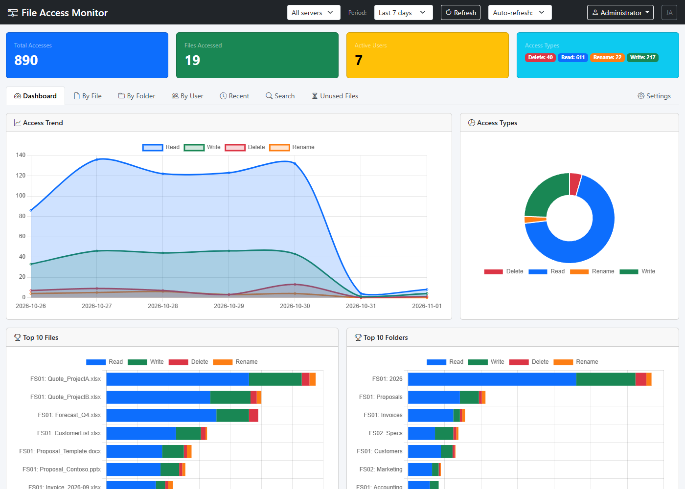
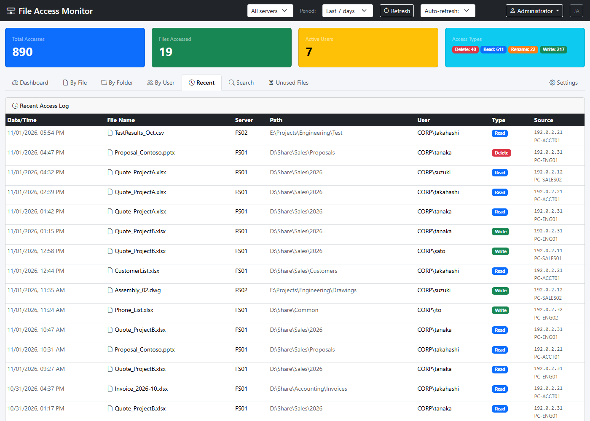
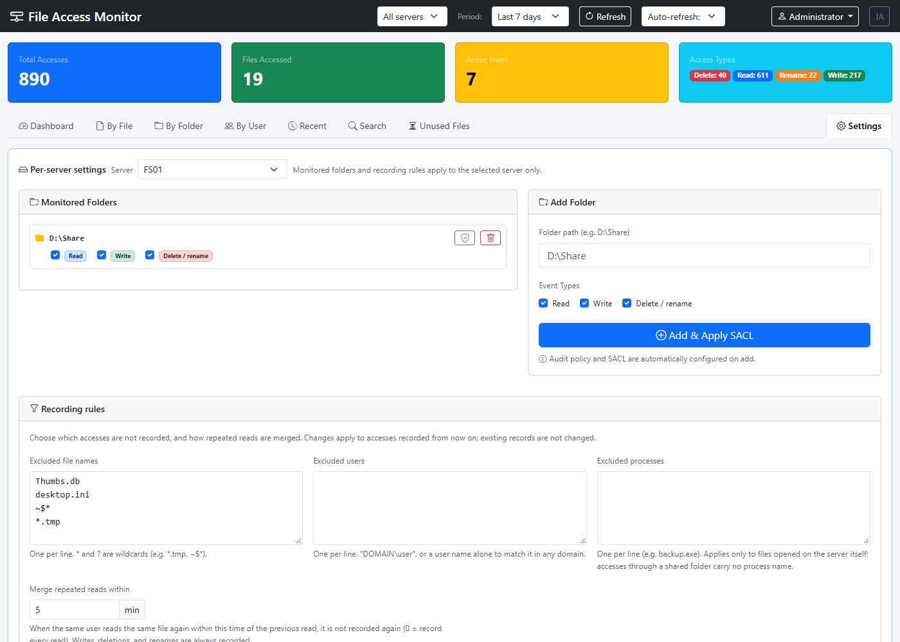

# FileAccessMonitor

English | [日本語](README.ja.md)

FileAccessMonitor records file access (read, write, create, delete, rename, permission changes, and refused attempts) on file servers' shared folders and shows it in a web GUI: from the Windows Security audit log on Windows file servers, and from Samba's audit log on Linux file servers that share folders with Samba. Agents bring the records of several file servers to one monitoring server, which runs on Windows or Linux and stores them in SQLite.



> [!IMPORTANT]
> This tool records who accessed which file and when. If you use it in an organization, tell the people being monitored in advance, in line with your workplace rules and privacy policy.

## Roles and requirements

FileAccessMonitor runs in two roles:

- **Monitoring server**: the web GUI, database, and notifications; it collects and shows the records. It can also record accesses to its own shared folders (**standalone**), or only show what agents send (**monitoring server only**).
- **Agent**: installed on a file server to monitor; it records that server's accesses and sends them to the monitoring server. It has no web GUI.

With one file server, install the monitoring server (standalone) on it and you are done. Install an agent on each further file server.

| | Monitoring server (Windows) | Monitoring server (Linux) | Agent (Windows) | Agent (Linux) |
|---|---|---|---|---|
| OS | Windows Server 2016 or later, Windows 10/11 | x86-64 Linux with systemd (tested on Rocky Linux 9.4) | Windows Server 2016 or later, Windows 10/11 | x86-64 Linux with systemd (tested on Ubuntu 24.04 and Rocky Linux 9.4) |
| Records | When standalone: this server's shared folders (Windows audit log) | With `--collect`: this server's Samba shares | This server's shared folders (Windows audit log) | Samba 4.x shares (access through SMB) |
| Rights | Administrator to install (the web GUI service runs without privileges; with local collection a second service, the collector, runs as SYSTEM) | root to install (the web GUI runs as its own user; with `--collect` a second service, the collector, runs as root) | Administrator to install (runs as SYSTEM) | root |
| Network | Inbound TCP 8080 (web GUI) and 8443 (agents) | Inbound TCP 8080 and 8443 | Outbound to the monitoring server's 8443 only | Outbound to the monitoring server's 8443 only |
| Download | `FileAccessMonitor-Setup-<version>.exe` | `fileaccessmonitor-server` rpm / deb (or tar.gz) | `FileAccessMonitor-Setup-<version>.exe` (choose **Agent**) | `fileaccessmonitor-agent` rpm / deb (or tar.gz) |
| Steps | [Install with the installer](#install-with-the-installer-recommended) | [8. Monitoring server on Linux](#8-monitoring-server-on-linux) | [6. Collect from several file servers](#6-collect-from-several-file-servers-agents) | [7. Linux file servers](#7-linux-file-servers-samba-agent) |

- Everything is published self-contained, so no .NET runtime needs to be installed (the .NET 10 SDK is needed only to build from source).
- The web GUI is used from a browser (Edge, Chrome, Firefox, and so on) on any PC that can reach the monitoring server.
- Only agents connect to the monitoring server; the monitoring server never connects to the file servers.

## Setup

### Install with the installer (recommended)

Download `FileAccessMonitor-Setup-<version>.exe` from [Releases](https://github.com/nuts-i77/FileAccessMonitor/releases) and run it on the Windows file server (or on the machine that will be the monitoring server, if that is a separate one). The installer does the following:

- Installs to `C:\Program Files\FileAccessMonitor`
- Registers and starts the Windows services: `FileAccessMonitor` (web GUI and database; runs as the virtual account `NT SERVICE\FileAccessMonitor`, without privileges) and, unless you chose monitoring only, `FileAccessMonitorCollector` ("File Access Monitor Collector"; runs as SYSTEM, records accesses and sets up auditing). An agent install has the one service `FileAccessMonitor` (SYSTEM). See [Which account runs what](#which-account-runs-what)
- Lets you choose how the server is used: **Standalone / monitoring server** (records accesses on this server and shows the web GUI), **Monitoring server only** (shows the web GUI and receives records from [agents](#6-collect-from-several-file-servers-agents), but does not record or change auditing on this server), or **Agent**
- Lets you choose the web GUI port (default 8080) and, optionally, adds a firewall rule that allows FileAccessMonitor.exe (the web GUI port and the agent port 8443)

When you run a newer installer, it upgrades the existing install and keeps your settings. Then continue with [3. First sign-in](#3-first-sign-in).

> [!NOTE]
> The installer is not code-signed, so Windows SmartScreen may show a warning. Choose **More info** → **Run anyway**. To check that the download is genuine, see [Verifying downloads](#verifying-downloads).

To build from source instead, follow steps 1 and 2.

### 1. Build (on your development PC)

```powershell
.\build.ps1
```

A self-contained EXE is written to `publish\`.

### 2. Install the service (on the server, in an elevated PowerShell)

Copy `publish\` and `install-service.ps1` to the server, then run:

```powershell
.\install-service.ps1
```

This does two things:

- Registers and starts the Windows services `FileAccessMonitor` and `FileAccessMonitorCollector`, with automatic startup (see [Which account runs what](#which-account-runs-what))
- Adds a Windows Firewall inbound rule for FileAccessMonitor.exe (TCP 8080, and 8443 for agents)

If WinRM is available, you can build and deploy from your development PC in one step:

```powershell
.\deploy-remote.ps1 -ServerIP <server name or IP>
```

### 3. First sign-in

Open `https://<server>:8080` in a browser (a new install uses HTTPS with a self-signed certificate, so the browser warns once; an install upgraded from before 1.9 stays on `http://` until you switch, see [Transport encryption](#security)) and sign in with:

- User name: `admin`
- Password: generated at random on first start and saved on the server in this file, which only SYSTEM, Administrators and the web GUI service account can read:

  ```
  C:\ProgramData\FileAccessMonitor\initial-admin-password.txt
  ```

After you sign in, open the user menu (top right) → **Change password** and set your own password. The file is deleted automatically when you change it.

### 4. Add folders to monitor

On the **Settings** tab, add a folder to monitor, for example `D:\Share`. When you add it, the tool does two things automatically:

- Enables the audit policies **File System** (success and failure), **Handle Manipulation** (failure only; without it refused opens are not logged) and **Authorization Policy Change** (success; permission changes)
- Sets audit entries (SACLs) on the folder and everything under it, for successful and refused reads, writes and deletes and for permission and owner changes

After upgrading from before 1.9, press **Re-apply SACL** once for each existing monitored folder (on Linux shares the same button re-applies the Samba auditing): until then refused access and permission changes are not recorded. The Settings page shows which folders still need it.

The **File Share** audit policy, used to find the client IP address, is enabled automatically when the service starts.

To configure auditing with scripts instead, run `setup-audit.ps1 -SharePaths "D:\Share"`. To undo it, run `restore-audit.ps1 -SharePaths "D:\Share"` (it also turns Handle Manipulation auditing off).

#### Create and renames on Windows (USN journal)

The Security log has neither the creation of a file nor the new name after a rename. FileAccessMonitor reads them from the NTFS change journal (USN journal) of the volume that holds a monitored folder: a file created by an access is then recorded as **Create** instead of Write, and a rename or move shows the new path. FileAccessMonitor does **not** create the journal. On a volume without one (and on FAT, exFAT and network paths) everything works as before: Write, and Rename with the old path only; the service log says so once per volume. Records are saved a few seconds later than before because they are matched with the journal first.

To check a volume and, if you want these records, enable the journal (elevated PowerShell; this is a system change that uses up to 32 MB):

```powershell
fsutil usn queryjournal D:
fsutil usn createjournal m=33554432 a=8388608 D:
```


### 5. Enlarge the Security log (recommended)

By default the Windows Security log holds only about 20 MB. On a busy server, older events are overwritten within hours. FileAccessMonitor collects events in real time, so its own records are not lost. A larger log still lets you check the original events later.

```powershell
wevtutil sl Security /ms:1073741824   # 1 GB
```

### 6. Collect from several file servers (agents)

One install can show the records of several file servers. Install FileAccessMonitor normally on the server that will show the web GUI (the monitoring server); on each other file server, install it as an **agent**, which only collects and sends. The monitoring server can be one of the file servers, or a separate machine installed as **Monitoring server only** (on Windows or [Linux](#8-monitoring-server-on-linux)).

To switch an existing monitoring server between recording accesses on itself and monitoring only, run `FileAccessMonitor.exe local-collection off` (or `on`) in an elevated PowerShell in `C:\Program Files\FileAccessMonitor` and restart the service. The command only changes the setting; also enable or disable the collector service: `sc.exe config FileAccessMonitorCollector start= auto` and `sc.exe start FileAccessMonitorCollector` (or `start= disabled` and `sc.exe stop FileAccessMonitorCollector`); running the installer again does it for you. On Linux, `sudo fileaccessmonitor-server --collect` or `--monitor-only` does all of it. **Settings → App info** shows the current mode.

1. Make sure the file servers can reach the monitoring server on TCP port **8443** (the agent port). The monitoring server always listens on it, and the installer's firewall option allows it: the rule allows FileAccessMonitor.exe, so it covers both the web GUI port and the agent port.
2. Under **Settings → Agents**, choose **Issue registration code**. If the file servers reach the monitoring server by another name or by IP address, change the address there and choose **Apply**. Copy the connection string; it is valid for 24 hours and can be used once.
3. On the file server, run the installer, choose **Agent**, and paste the connection string. To turn an existing install into an agent, run in an elevated PowerShell:

   ```powershell
   & "C:\Program Files\FileAccessMonitor\FileAccessMonitor.exe" enroll <connection string>
   Restart-Service FileAccessMonitor
   ```
4. On the file server, set up auditing of the shared folders in an elevated PowerShell. `-ExecutionPolicy Bypass` runs this one script even where scripts are disabled:

   ```powershell
   powershell -ExecutionPolicy Bypass -File "C:\Program Files\FileAccessMonitor\scripts\setup-audit.ps1" -SharePaths "D:\Share"
   ```

How it works and limits:

- A 1.8 agent works with a 1.9 monitoring server. A 1.9 agent that talks to a 1.8 server sends records without the new data (refused access and permission changes are not sent, Create is sent as Write, no new paths); records waiting in the outbox are not rewritten, so they arrive in full once the server is upgraded.
- Agents connect to the monitoring server; the monitoring server never connects to them. The connection uses HTTPS with a certificate the monitoring server creates itself; agents trust exactly that certificate (its fingerprint is in the connection string), so no certificate authority is needed.
- Records are kept in a local outbox on the agent (`C:\ProgramData\FileAccessMonitor\outbox`, up to 2 GB) until the monitoring server has saved them, so nothing is lost while it is unreachable.
- When the outbox is full (2 GB), the agent does not drop records: collection on that server pauses and the agent checks every 30 seconds for room. The records stay in the Security log (Linux: the journal) and are collected after the monitoring server is reachable again and the agent has sent the waiting data. This works only as long as the log has not wrapped: if the Security log overwrites records first, the existing recording-gap notice reports the missing range (Linux agents notice a rotated journal when they start reading again). The agent reports the state in its heartbeat; the **Agents** tab shows **Send queue full**, and a notification is sent once (when notifications are on). Enlarge the Security log on busy servers (step 5) to give more room.
- When records come from more than one server, a server filter appears at the top of the web GUI, and lists get a **Server** column.
- Monitored folders and recording rules are set per server: pick the server at the top of the **Settings** tab. An agent picks up changes within a minute. When a folder is added on an agent's server, the agent checks it exists and sets its audit entries (SACL); the **Unused Files** tab lists files on the chosen server through its agent. These need the agent to be online. Until folders are set for an agent's server, the agent records every audited access on it.
- Viewing scopes can name a server for each folder (or apply to the path on every server).
- The **Agents** list shows each agent's OS (Windows or Linux), last contact, version (flagged when it differs from the monitoring server's, with **How to update** showing the commands to run on that file server), batches waiting to be sent, and whether file access auditing is on. When notifications are on, an agent that has not been in touch for 15 minutes (configurable; 0 turns it off) is reported, and again when it is back.
- Alerts and notifications name the file server the accesses happened on.
- Record times come from each file server's clock; keep the servers' clocks synchronized (NTP; domain members do this by default).
- `FileAccessMonitor.exe unenroll` turns an agent back into a standalone install.

To change the agent port:

1. Add the following to `C:\ProgramData\FileAccessMonitor\settings.json` on the monitoring server. Keep the other settings in the file.

   ```json
   "Agents": { "Port": 9443 }
   ```
2. Restart the service with `Restart-Service FileAccessMonitor`. The firewall rule made by the installer allows the program, not a port, so it needs no change.
3. Registered agents keep the old address. Issue a new connection string and, on each file server, run `FileAccessMonitor.exe enroll <connection string>` and restart the service.

If you do not use agents and do not want the port open, set `"Agents": { "Enabled": false }` instead.

### 7. Linux file servers (Samba agent)

A Linux file server that shares folders with Samba can send its records to the monitoring server too. The Linux agent reads the audit lines of Samba's `full_audit` module from the systemd journal; it records accesses through SMB shares (not NFS, and not changes made on the server itself).

Requirements: x86-64 Linux with systemd and Samba 4.x (tested on Ubuntu 24.04 with Samba 4.19 and Rocky Linux 9.4 with Samba 4.23; Debian, RHEL and AlmaLinux work the same way), and root.

1. Download the package for your distribution from the release page: `fileaccessmonitor-agent-<version>-1.x86_64.rpm` (RHEL, Rocky, Alma) or `fileaccessmonitor-agent_<version>-1_amd64.deb` (Ubuntu, Debian).
2. Issue a connection string under **Settings → Agents** on the monitoring server, then run as root:

   ```sh
   sudo dnf install ./fileaccessmonitor-agent-<version>-1.x86_64.rpm     # or: sudo apt install ./fileaccessmonitor-agent_<version>-1_amd64.deb
   sudo fileaccessmonitor-agent enroll <connection string>
   sudo systemctl enable --now fileaccessmonitor-agent
   ```
   Without a package manager, use `FileAccessMonitor-<version>-linux-x64-agent.tar.gz`: unpack it and run `sudo sh install.sh <connection string>`.

   The agent runs as the systemd service `fileaccessmonitor-agent` (log: `journalctl -u fileaccessmonitor-agent`); its data is in `/var/lib/fileaccessmonitor`. Upgrade it by installing the newer package (`dnf install` / `apt install` again).
3. Restart Samba once when convenient (`systemctl restart smbd`, or `smb` on RHEL). The installer adds a setting so that journald does not drop Samba's audit lines when there are many of them; it takes effect when Samba restarts.
4. On the **Settings** tab of the monitoring server, pick the Linux server and add folders by their Linux path, such as `/srv/share/docs`.

How it differs from Windows:

- Adding a folder turns on auditing for the Samba shares that hold it (or are inside it), by editing `smb.conf`: the agent checks the new configuration with `testparm`, keeps a backup (`smb.conf.fam-backup-<time>`), and reloads Samba. Its lines sit between `# FileAccessMonitor begin` and `# FileAccessMonitor end`; lines it replaced (a share's own `vfs objects` or `full_audit` settings) are kept as comments and come back when the folder is removed with **Stop monitoring + remove SACL**. Shares defined in included files or in the registry are not changed.
- Auditing starts with new connections to the share; clients that are already connected are recorded after they reconnect.
- Paths are case-sensitive. User names are those Samba logs in (`DOMAIN\user` on domain members); the client machine name comes from the SMB connection.
- Reads and writes are the access the client asked for when opening a file, as on Windows; deletions and renames are recorded when they happen. Refused access, permission changes, creation and the new path of renames are recorded too (see [Access type classification](#access-type-classification-accessmask)). Shares that were set up by an earlier version need **Re-apply SACL** (the same button) once to get the failure and permission auditing; Samba then logs every failed open, so the journal grows faster. Turn off **Also record refused access** under Settings → Recording and re-apply to avoid that.
- To remove the agent: remove its folders on the monitoring server first, then `sudo dnf remove fileaccessmonitor-agent` or `sudo apt remove fileaccessmonitor-agent` (`apt purge` also deletes its registration and waiting records). With the tar.gz, run `sudo sh install.sh --uninstall` in the unpacked folder (add `--purge` to delete its data too).

### 8. Monitoring server on Linux

The monitoring server (web GUI, database, notifications, agent port) also runs on Linux. It can show only what agents send, or also record the Samba accesses of the Linux machine it runs on.

Requirements: x86-64 Linux with systemd (tested on Rocky Linux 9.4; Ubuntu, Debian, RHEL and AlmaLinux work the same way), and root to install.

```sh
sudo dnf install ./fileaccessmonitor-server-<version>-1.x86_64.rpm   # RHEL, Rocky, Alma
sudo apt install ./fileaccessmonitor-server_<version>-1_amd64.deb    # Ubuntu, Debian
```

A new install is **monitoring only** and runs as the user `fileaccessmonitor`. The `fileaccessmonitor-server` command shows and changes how it runs:

```sh
fileaccessmonitor-server                        # mode, port and service state
sudo fileaccessmonitor-server --collect         # also record this machine's Samba accesses (collector service, runs as root)
sudo fileaccessmonitor-server --monitor-only    # back to monitoring only
sudo fileaccessmonitor-server --port 8090       # web GUI port (default 8080)
sudo fileaccessmonitor-server --https on|off    # HTTPS for the web GUI (see Security)
```

Without a package manager, use `FileAccessMonitor-<version>-linux-x64-server.tar.gz`: unpack it and run `sudo sh install.sh` (options: `--collect`, `--monitor-only`, `--port <number>`, `--https on|off`).

- The server is installed to `/opt/fileaccessmonitor` and runs as the systemd service `fileaccessmonitor`, as the unprivileged user `fileaccessmonitor` (log: `journalctl -u fileaccessmonitor`). With `--collect`, the systemd service `fileaccessmonitor-collector` runs as root and records the machine's Samba accesses (log: `journalctl -u fileaccessmonitor-collector`); upgrading from 1.10 or older replaces its former root drop-in with it. Records and settings are in `/var/lib/fileaccessmonitor`, readable by the service account only; the collector keeps its own state in `/var/lib/fileaccessmonitor/collector` (root only, except `key.hash`). The tamper-detection key `chain.key` and `chain-head.json` are there too: back them up with the database.
- Sign in at `https://<server>:8080` as `admin` (a new install uses HTTPS with a self-signed certificate; the browser warns once); the initial password is in `/var/lib/fileaccessmonitor/initial-admin-password.txt` (`sudo cat` it).
- Open TCP 8080 and 8443 in the firewall if it is on, for example `firewall-cmd --permanent --add-port=8080/tcp --add-port=8443/tcp && firewall-cmd --reload` or `ufw allow 8080/tcp && ufw allow 8443/tcp`. The packages do not change the firewall.
- Upgrades (installing a newer package, or running `install.sh` again) keep the mode and port.
- With `--collect`, add the machine's own folders on the **Settings** tab (it appears as a server like the agents) and auditing is set up the same way as on a [Linux agent](#7-linux-file-servers-samba-agent). A machine runs either the monitoring server or the agent, not both; installing one package replaces the other.
- The notification secrets (webhook URL, SMTP password) are encrypted with keys in `/var/lib/fileaccessmonitor/keys`, protected by the folder's permissions (on Windows the keys are also encrypted with the machine's DPAPI).
- To remove it: `sudo dnf remove fileaccessmonitor-server` or `sudo apt remove fileaccessmonitor-server`; records and settings are kept (`apt purge` deletes them). With the tar.gz, `sudo sh install.sh --uninstall` in the unpacked folder (`--purge` also deletes records and settings).

## Security

- **Privilege separation**: the web GUI, the API and the database never run with elevated rights (see [Which account runs what](#which-account-runs-what)). What needs them (reading the Security log, setting SACLs, scanning shares and ACLs) is done by a second process, the collector, which has no web interface and listens on no port. The two talk over the loopback address on the agent port, and the collector proves itself with a random secret that only SYSTEM (root) can read; the web service holds only its hash.
- **JWT signing key**: generated at random on first start and saved to `C:\ProgramData\FileAccessMonitor\jwt.key`, which only SYSTEM, Administrators and the web GUI service account can read. If you set a `Jwt:Key` of 32 bytes or more in `appsettings.json`, that key is used instead.
- **Sign-in lockout**: after 5 failed sign-ins in a row, the account is locked for 15 minutes.
- **Viewing scopes**: under **Settings → User Management**, an Admin can limit a Viewer to some folders, for example one department's share. That user then sees only records inside those folders, everywhere including CSV export and the Unused Files tab, and can be given an email address that receives alerts about those folders. Admins see everything. A Viewer with no folders sees nothing; to let a Viewer see everything, choose **All folders** (Viewers that had no folders before 1.11 were set to All folders once on upgrade). Changes apply on the user's next request.
- **Sign-in sessions**: a sign-in stays valid for `Jwt:ExpiresHours` (default 24 hours), but ends immediately when the user is deleted, their role changes, or their password is changed or reset.
- **Operation log**: sign-ins (including failures), user management, setting changes, CSV exports, and notifications sent are recorded and shown under **Settings → Operation Log** (Admin only).
- **Notification secrets**: the webhook URL and SMTP password are stored encrypted (ASP.NET Core Data Protection with machine DPAPI; keys in `C:\ProgramData\FileAccessMonitor\keys\`).
- **Tamper detection**: records changed, deleted or added outside the program are detected with the key in `chain.key` (and `chain-head.json`) in the data folder. Back both up with the database. Records saved before 1.10 are not protected, and restoring an older database shows as a finding to accept after checking it. Someone with administrator rights on the server who also has the key can rebuild the chain; copies of the daily anchors kept elsewhere (the report mail, a downloaded anchor file, a forwarded event log) show that. See **Settings → Tamper detection**.
- **Transport encryption**: the web GUI serves HTTPS itself, on the same port as before. A **new install** has it on, with a self-signed certificate that the server creates (it covers the machine name, its addresses and `localhost`, and is made again if one is missing); browsers warn about it once. An install upgraded from before 1.9 stays on HTTP until you switch (the Windows installer asks; silent installs use `/HTTPS=1` or `/HTTPS=0`). Switch with these commands, then restart the service; `status` shows the current setting:

  ```powershell
  # Windows, in C:\Program Files\FileAccessMonitor
  .\FileAccessMonitor.exe web-https on|off|status
  ```

  ```sh
  # Linux
  sudo fileaccessmonitor-server --https on|off
  ```

  To use your own certificate instead, give a PFX file: `FileAccessMonitor.exe web-https on --pfx cert.pfx --pfx-password <password>` (Linux: `sudo fileaccessmonitor-server --https on --pfx cert.pfx --pfx-password-file pw.txt`). The certificate needs a private key; a warning is printed if it does not match the machine name. `--redirect-port 8081` also opens a plain HTTP port that redirects browsers to the HTTPS port. After switching, old `http://` bookmarks stop working unless you use the redirect port. If the certificate cannot be loaded, the web GUI is served over HTTP on the machine itself only (`localhost`, never on other interfaces) so that you can still sign in there; the log says why and how to fix it (`FileAccessMonitor.exe web-https status`, a new PFX, or `web-https off` behind a reverse proxy), and **Settings** shows the reason. The redirect port stays closed in that case. **Settings** shows the certificate in use (read-only), and an Admin who opens the GUI over plain HTTP sees a warning. The agent port 8443 has its own certificate and is not affected. There is no HSTS header, so you can always accept the self-signed certificate. Behind a reverse proxy you can leave HTTPS off (see [docs/https.md](docs/https.md)).
- **Roles**: `Admin` can change settings and manage users. `Viewer` can only view.

To report a vulnerability, please follow [SECURITY.md](SECURITY.md) instead of opening a public issue.

### Which account runs what

| | Windows | Linux |
|---|---|---|
| Web GUI, API, database, notifications, agent port | Service `FileAccessMonitor`, virtual account `NT SERVICE\FileAccessMonitor` (no password, no privileges) | systemd `fileaccessmonitor`, user `fileaccessmonitor` |
| Recording on this server, setting up auditing, scanning folders and permissions (only while local collection is on) | Service `FileAccessMonitorCollector`, SYSTEM | systemd `fileaccessmonitor-collector`, root |
| Agent | Service `FileAccessMonitor`, SYSTEM (unchanged) | systemd `fileaccessmonitor-agent`, root |

The collector is the same program started with the argument `collector`. It works like a built-in agent: it sends its batches to `https://127.0.0.1:<agent port>` (trusting that certificate by its fingerprint), takes the monitored folders and recording rules from the web service, and runs the web GUI's jobs (setting SACLs, scanning for unused files, permission scans). It needs no registration. It shows in **Settings → Agents** as a row for this server (status only), and a stopped collector is notified like an offline agent. If it is not running, the GUI says so and records are not made until it is started again (the Security log keeps the events meanwhile, as when an agent is stopped). Its own state is in `collector\` below the data folder, which the web service cannot read.

If the web service does not stay running under `NT SERVICE\FileAccessMonitor` after an install or upgrade, the installer switches it back to LocalSystem (as in 1.10) so that it keeps working, and writes a warning to `logs\service-install.log`. Check the account with `Get-CimInstance Win32_Service -Filter "Name like 'FileAccessMonitor%'" | Select-Object Name, State, StartName`, find the cause in `logs\app-*.log` (or the Application event log), and run the installer again once it is fixed.

The separation limits what a flaw in the web part can do, but the web service still decides what the collector does: someone who takes over the web service account can change the monitored folders and ask the collector for folder and permission scans (file names, sizes and ACLs, not file contents), and can change or delete records. Treat the monitoring server as a system to protect: reach the web GUI from the management network only, keep it updated, and send the tamper-detection anchors off the server ([How tamper detection works](docs/integrity.md)). The recommended layout is a monitoring server that only monitors (Linux, user `fileaccessmonitor`) with agents on the file servers.

## Configuration

### appsettings.json (in `publish\`)

| Setting | Description | Default |
|---|---|---|
| `Kestrel.Endpoints.Http.Url` | Listen URL | `http://0.0.0.0:8080` |
| `Jwt:ExpiresHours` | How long a sign-in stays valid, in hours | `24` |
| `Jwt:Key` | JWT signing key (usually not needed; see above) | Auto-generated |
| `ExcludeSystemAccounts` | Ignore access by SYSTEM and computer accounts (`xxx$`) | `true` |
| `ExcludeProcessNames` | Process names to ignore | `System`, `svchost.exe`, `SearchIndexer.exe` |

With the installer, `appsettings.json` is in `C:\Program Files\FileAccessMonitor\` and is replaced on upgrade. Put your own changes in `appsettings.Production.json` in the same folder instead. The installer creates that file with the port you chose, and your changes to it are kept on upgrade.

### Runtime settings and data (`C:\ProgramData\FileAccessMonitor\`)

| File | Contents |
|---|---|
| `settings.json` | Monitored folders, recorded access types, reverse-DNS server, retention, notifications (edited from the GUI); whether this server records accesses on itself (`LocalCollection`); HTTPS for the web GUI (`Web:Https`, written by `web-https`) |
| `web-https.pfx` / `web-user.pfx` | The web GUI certificate (the self-signed one, or the certificate you gave with `--pfx`). Before 1.11 the self-signed one on Windows was kept in the machine certificate store; such a certificate is still used as long as it is there |
| `agent-endpoint.pfx` | The agent port certificate (self-signed; agents pin its fingerprint). A certificate that 1.10 or older made in the machine store keeps being used, so the fingerprint does not change |
| `fileaccess.db` | Access records (SQLite) |
| `logs\app-YYYYMMDD.log` | Application log of the web service (kept for 14 days) |
| `logs\service-install.log` | What the installer did to the services, accounts and folder permissions (look here when it says the service could not be registered or started) |
| `collector\` | State of the collector service, for SYSTEM and Administrators only (the web service may read `collector\key.hash`, the hash of the collector's secret): `key.secret`, `settings.json` (a copy of this server's monitored folders and recording rules), `outbox\`, `logs\collector-YYYYMMDD.log` |
| `jwt.key` | JWT signing key |
| `chain.key` | Key of the tamper-detection chains. Back it up with `fileaccess.db`; without it the old records cannot be verified |
| `chain-head.json` | Last verified end of each chain (tamper detection). Back it up with `fileaccess.db` |
| `permission-reports\` | Latest permission scan of each monitored folder (**Permissions** tab) |

The data folder is open to SYSTEM, Administrators and the web service account only (on an agent: SYSTEM and Administrators); the installer sets this, since `ProgramData` would otherwise let every local user read it. **Keep backups of it just as closed**: they hold every record, `chain.key` (with it the tamper-detection chain can be rebuilt) and `jwt.key` (with it anyone can make a valid sign-in, including as an Admin). Copying the folder with Explorer or `Copy-Item` gives the copy the permissions of where it lands (for example `C:\Temp`, which Users can read); copy with `robocopy <data folder> <backup folder> /E /COPYALL`, or into a folder that only Administrators can open.

## Web GUI

| Tab | Contents |
|---|---|
| Dashboard | Access trend chart, breakdown by type, a count of refused attempts, top files and folders. Click a value in a chart to open its records in Search, or the file or folder detail |
| Files / Folders / Users | Rankings with detail dialogs |
| Recent | Access log with client IP and machine name. Refused attempts have a red **Denied** mark and can be shown or hidden with the Result filter; a renamed file shows its new path; permission changes have an info button with what changed. Each file name has a clock button that opens its history (see below) |
| Search | Search by keyword, period, type, or IP; export the results as CSV (up to 200,000 rows, opens in Excel) |
| Unused Files | Files in a monitored folder that nobody read (or accessed) in a period, found by scanning the folder, with their size totaled per subfolder (Admin only; up to 100,000 files per scan) |
| Permissions | Who may do what in a monitored folder as of the last scan: entries that are not simply inherited, broad access (Everyone, Authenticated Users, ...) and folders that do not inherit. Scans are started by Admins only; a Viewer with a folder scope sees the stored result for their folders |
| Settings | Monitored folders, users, recording rules (exclusions and merging of repeated reads), reverse DNS, data retention, notifications, scheduled report, tamper detection, operation log |

Notifications (Teams, Slack, a webhook, or email) are sent when one user deletes, writes, or reads at least a set number of files within a few minutes (mass reads are off by default), when one user is refused access at least a set number of times (**denied burst**, 20 in 5 minutes by default), when a user's activity looks like ransomware (**high priority**, see below), and when recording was interrupted: Security log events were overwritten before they were collected, or the log was cleared (with the user who cleared it); on Linux servers, journald dropped audit lines or the journal no longer had them. Agents that stop reporting are notified too. If the internet is reached through a proxy, set it in the notification settings (webhooks only; the service runs as a service account, so a signed-in user's Windows proxy setting does not apply).

The webhook cannot point to this machine (localhost, `127.x.x.x`, `::1`), to link-local addresses (`169.254.x.x`, which includes the cloud metadata address, and `fe80::`), or to unspecified or multicast addresses; this is checked when the URL is saved and again when the connection is made (so a name that resolves to such an address is refused too), and redirects are not followed. Private addresses (`10.x`, `172.16-31.x`, `192.168.x`) are allowed, for chat servers inside the network.

**Ransomware-like behaviour** is checked per user over 2 minutes, by three rules: at least 20 files renamed to the same new extension (not a harmless one such as `.tmp`; needs the new path, so on Windows the USN journal), at least 100 writes together with at least 50 renames, and a ransom-note file name (`README_DECRYPT.txt`, `HOW_TO_RECOVER_FILES.html` and similar) created in at least 3 folders. Such an alert is sent with high priority (a "[HIGH PRIORITY]" mark; high importance for mail) and names the rule and the files. Nothing is blocked or disconnected automatically. It is on by default and can be turned off in the alert settings; the numbers are in `settings.json` under `Alerts`. Alerts must be turned on, as for the other alerts.

**File history.** The clock button next to a file name (in the Recent log, in search results, in the By File table, and in the file and folder detail dialogs) opens the history of that file or folder: how it came to be where it is, and what happened to it since, following renames and moves. Folder renames and moves are followed too, but a rename is recorded together with the Delete access type, so Delete must be monitored for that folder. Viewers see only the steps inside their folders; other steps are shown as a gap. The history can be exported as CSV.

**Permissions report.** The **Permissions** tab shows the permissions of a monitored folder and below it as of the last scan: entries that are not simply inherited, broad access (recognized by SID, so it works in any Windows language) and folders that do not inherit their permissions. Admins start a scan with **Scan now**. On Linux the report also shows the POSIX permissions and the Samba share settings (`guest ok`, `read only`, `valid users`, `write list`). NT ACLs of shares that use `acl_xattr` or `acl_tdb` are not read, and the report warns about them. A scan reads folders only by default (files nearly always inherit their folder's permissions); untick **Folders only** to look at files too. A scan stops at its limits (5,000 folders and 50,000 files by default; 20,000 rows in the result) and says which one; scan a subfolder with the button next to it, or type a folder below the monitored one in **Folder** and select **Scan now**. The button next to **Folder** lists the monitored folders and the subfolder scans. An Admin can delete a subfolder scan result with **Delete**. The permissions job needs agents of version 1.10 or later.

**Scheduled report e-mail.** Off by default. Under **Settings → Notifications**, the **Scheduled report** card sends a summary by e-mail daily, weekly or monthly, at the server's local time. It covers accesses, refused attempts, permission changes, the top files, folders and users, and the broad permissions of the last stored scans (the report never starts a scan). Admins also get alerts, the agents' state and the tamper-detection state. CSV attachments are optional. Each Viewer with a notification address gets a report limited to their folders, unless the **Also send the scheduled report** box in their scope dialog is unticked. E-mail must be set up first. **Send a test report now** sends one without changing the schedule.

**Tamper detection.** Each new access record and operation-log entry is chained to the one before it with a keyed hash. Records that are changed, deleted, added or reordered outside the program are found by verification (every 15 minutes, and in full every night) and raise a high-priority alert. The **Tamper detection** card in Settings shows the state, lets you verify now, download a signed anchor and accept a finding after checking it. Every day the end of each chain is written to the Windows event log (source `FileAccessMonitor`, event 1100) or to syslog (tag `fileaccessmonitor`), and it is included in the scheduled report. The key is `chain.key` in the data folder: back it up with the database. Records saved before 1.10 are not protected. See [How tamper detection works](docs/integrity.md) for the details and operation.

The GUI is available in English and Japanese. Switch languages at the top right; on first visit the GUI follows the browser's language. Messages returned by the API use the selected language too.

**Recent access log** — who opened which file, on which file server, from which IP address and machine:



**Settings** — per-server monitored folders and recording rules (here for the agent FS01), then the settings for all servers:



The screenshots use fictional sample data.

## How it works

1. Subscribes to the Windows Security event log in real time (events 4663, 4659, 4660, 4670 for permission changes, and failed 4656 for refused opens), and reads the NTFS change journal for creations and new names.
2. Finds the client IP address and machine name from logon (4624) and share access (5140) events and from the list of SMB sessions.
3. Stores records in SQLite and aggregates them through an ASP.NET Core web API.
4. Displays them in the browser with Bootstrap and Chart.js.

Agents on other Windows file servers do steps 1 and 2 and send the records to the monitoring server over HTTPS. Linux agents read Samba's audit lines from the systemd journal instead (see [7. Linux file servers](#7-linux-file-servers-samba-agent)).

### Access type classification (AccessMask)

| Type | Mask |
|---|---|
| Read | `0x1` (ReadData) / `0x80000000` (GENERIC_READ) |
| Write | `0x2` (WriteData) / `0x4` (AppendData) / `0x40000000` (GENERIC_WRITE) |
| Delete | `0x10000` (DELETE) followed by event 4660 (object deleted) for the same handle, and event 4659 |
| Rename | `0x10000` (DELETE) with no event 4660: the file was renamed or moved. The new path comes from the USN journal when available |
| Create | A write that created the file, found through the USN journal (see [Create and renames on Windows](#create-and-renames-on-windows-usn-journal)); without the journal it is a Write |
| Permission | Event 4670 (permissions or owner changed); the record shows the change (owner, added and removed entries, inheritance) |
| Denied | Not a type of its own: a refused read, write or delete (event 4656 with Audit Failure) is a record of that type marked **Denied** |

Refused access is recorded for files and for folders (opening or listing a forbidden folder), merged per user, path and type within 60 seconds. Denied records are not counted as accesses in rankings, statistics, unused-file detection or the read, write and delete alerts. They can be turned off under **Settings → Recording**. On Windows a refused rename shows as a refused Delete.

On Linux (Samba), a refused open is logged by Samba as a failed `create_file` and the same for delete and rename; to find refusals the agent records a failed open when the error is "Permission denied" or "Operation not permitted", and also when it says "No such file or directory" but the path exists (Samba checks access itself and leaves an old error code behind). A failed open of a path that does not exist is not recorded. Create is recorded only for create-only opens (clients that "create or open" are recorded as Write), a rename shows its new path, and a permission change (`fset_nt_acl`) is recorded without before/after details.

Renames and moves also open the file with DELETE access, so a DELETE access is held for up to 2 seconds until event 4660 shows whether the file was actually deleted. A write or rename is then held a few more seconds while it is matched with the USN journal (see above). If it was not, and a file exists again at the same path (Office saves a document by renaming the old file away and a new file into its place), the access is recorded as a write. Renames are recorded for folders where Delete is selected; Create is recorded where Write is selected.

Folders are recorded only when they are deleted, renamed or have their permissions changed (and, when refused, when opened), shown with a folder icon and marked in the CSV export. They are left out of the file ranking and of mass-deletion alerts, which already count the files inside. Opening a folder or adding files to it is not recorded.

### Recording rules

On the **Settings** tab, administrators can exclude file name patterns (`*` and `?` wildcards), users, and processes, and merge repeated reads: when the same user reads the same file again within the set time of the previous read (5 minutes by default), it is not recorded again. The window restarts with each read, so watching a long video with seeks counts as one read. By default `Thumbs.db`, `desktop.ini`, `~$*` (Office lock files), and `*.tmp` are excluded. The rules apply to accesses recorded after they are saved.

## Comparison with other tools

FileAccessMonitor aims at one job: letting a small team see who read, changed, or deleted files on their file servers, without building a log platform. If you need more than that, another tool is likely a better fit.

| | FileAccessMonitor | Commercial auditing products<br>(e.g. Netwrix Auditor, ManageEngine ADAudit Plus) | Wazuh |
|---|---|---|---|
| Cost | Free (MIT) | Paid licenses | Free (open source); paid cloud and support available |
| Setup | One installer on the file server; an agent on each further file server | Installer; often needs a separate server and database | Wazuh server, indexer, and dashboard, plus an agent on each host |
| Scope | File access on Windows file servers and Linux Samba file servers | File servers, NAS, Active Directory, Microsoft 365, and more | Security monitoring (SIEM/XDR) across many hosts |
| Who **read** a file | Yes (Security log events 4663/4659; Samba's audit module on Linux) | Yes | File integrity monitoring covers changes only; reads need Security-log collection and your own rules |
| Multiple servers in one view | Yes (agents send to one monitoring server) | Yes | Yes |
| Alerts | Mass delete / change / read, bursts of refused access, ransomware-like behaviour (high priority, no automatic response), and gaps in recording, to Teams, Slack, a webhook, or email | Many built-in rules | Flexible rules and automated responses |
| Failed (refused) access | Yes (recorded as **Denied**) | Yes | Needs Security-log collection and your own rules |
| Permission changes | Yes (Windows with details; Linux without before/after) | Yes | Needs Security-log collection and your own rules |
| Reports | Search and CSV export | Built-in compliance and scheduled reports | Dashboards and compliance mappings |
| Japanese UI | Yes | Varies by product | No |
| Support | Community (GitHub Issues), no SLA | Vendor support | Community, or paid vendor support |

**When to choose which**

- **FileAccessMonitor**: you have one or several Windows or Samba file servers, want answers to "who deleted this file?" or "who opened this folder?", and do not want to run a log platform.
- **A commercial product**: you need to audit NAS appliances, AD, or Microsoft 365 together with the file servers, need compliance reports, or need vendor support.
- **Wazuh**: you are building organization-wide security monitoring and file access is one of many sources.

Product capabilities above are summarized from public information and may change. Check each vendor's documentation for details.

## Limitations

- **Operations that do not open a file are not recorded.** This includes reading only attributes or timestamps (`0x80` ReadAttributes and similar) and listing folders (a refused listing of a folder is recorded). For example, when an incremental backup tool finds a file unchanged and skips copying it, that file is not recorded.
- Events that occur while the service is stopped (for example during an upgrade or reboot) are collected when it starts again, as long as they are still in the Security log (the journal on Linux). If they are already gone, the gap is recorded in the operation log and notified.
- Each file server needs FileAccessMonitor installed (standalone, or as an agent). Servers without it, and NAS appliances, cannot be monitored.
- On Linux, only accesses through Samba (SMB) shares are recorded; NFS and changes made on the server itself are not.
- Renames and moves record the new path where it is available: on Windows from the NTFS USN journal (volumes without one, FAT, exFAT and network paths record only the old path), on Linux from Samba. A move into a monitored folder from outside it is not recorded, because the old path is not monitored; a move to another volume is a delete plus a create.
- Create is recorded only with the USN journal on Windows, and only for create-only opens on Linux; otherwise it is a Write. Copying a file on Windows can record one Permission change for the new file, because Windows sets its security while copying; with the USN journal such a record is labelled **set at creation** and is not counted as a permission change in the scheduled report (records made before 1.10.2 are not labelled). A refused rename on Windows is recorded as a refused Delete.
- Tamper detection cannot vouch for records saved before 1.10, and cannot stop an administrator who also has `chain.key`; only anchors kept off the server show that.
- Permission reports show the POSIX view on Linux and do not read Samba NT ACLs (shares that use `acl_xattr` or `acl_tdb` get a warning). Groups are not expanded, and a scan is a snapshot as of its date.
- Ransomware-like detection uses fixed thresholds (in `settings.json`, `Alerts`) and takes no action: slow encryption below the window is missed, and a bulk move that changes many extensions can raise a false alert. Refused-access detection on Linux depends on Samba's error text and on its language (English and Japanese texts are known).
- A folder that is deleted or renamed is recognized as a folder when it is still there as the event is processed, or when accesses to files inside it were seen recently. Otherwise (for example an empty folder) it is recorded as a file.
- Times are stored in UTC. The GUI shows them, and groups them by day, in the browser's time zone.

## Development

```powershell
dotnet build FileAccessMonitor.csproj
dotnet test tests/FileAccessMonitor.Tests
dotnet test linux-agent/tests            # Linux agent (runs on Windows too)
```

The Linux agent is the project in `linux-agent/`; it shares the agent protocol, outbox, and recording rules with the Windows service (linked source files). Build it with `dotnet publish linux-agent/FileAccessMonitor.Agent.Linux.csproj -c Release -r linux-x64 --self-contained true /p:PublishSingleFile=true`. The monitoring server builds for Linux from the main project: `dotnet publish FileAccessMonitor.csproj -c Release -r linux-x64 --self-contained true /p:PublishSingleFile=true /p:InvariantGlobalization=true /p:PredefinedCulturesOnly=false` (the files for the `linux-server/` installer).

To build the installer locally, install [Inno Setup 6](https://jrsoftware.org/isinfo.php) and run `.\build-installer.ps1 -Version 1.0.0`. The output goes to `dist\`.

To run a second instance for development or demos without touching an installed one, set the `FILEACCESSMONITOR_DATA` environment variable to another data folder (default `C:\ProgramData\FileAccessMonitor`) and another port, e.g. `$env:Kestrel__Endpoints__Http__Url = 'http://localhost:5099'`.

GitHub Actions (`.github/workflows/ci.yml`) builds, tests, and publishes the app on every push and pull request. Pushing a tag such as `v1.0.0` runs `.github/workflows/release.yml`, which builds the installer, a portable zip, and the Linux agent's and monitoring server's tar.gz and publishes them as a GitHub Release.

## Uninstall

If you used the installer, uninstall **File Access Monitor** from **Settings → Apps**. The services and firewall rule are removed. Access records, settings, and keys stay in `C:\ProgramData\FileAccessMonitor\`; delete that folder if you no longer need them. To remove the audit entries (SACLs), run `C:\Program Files\FileAccessMonitor\scripts\restore-audit.ps1` before uninstalling.

If you installed from source:

```powershell
.\install-service.ps1 -Uninstall
.\restore-audit.ps1 -SharePaths "D:\Share"   # to remove the audit settings as well
```

To remove a Linux agent or a Linux monitoring server, see [7. Linux file servers](#7-linux-file-servers-samba-agent) and [8. Monitoring server on Linux](#8-monitoring-server-on-linux).

## Verifying downloads

The release files are built by this repository's [release workflow](.github/workflows/release.yml) on GitHub Actions from the tagged source. Each release includes a GitHub [build provenance attestation](https://docs.github.com/actions/security-for-github-actions/using-artifact-attestations), so you can check that a file was built there and has not been modified. With the [GitHub CLI](https://cli.github.com/), run:

```powershell
gh attestation verify FileAccessMonitor-Setup-<version>.exe -R nuts-i77/FileAccessMonitor
```

Without the GitHub CLI, compare the output of `Get-FileHash <file>` (on Linux, `sha256sum <file>`) with `SHA256SUMS.txt` on the release page.

## Privacy policy

This program will not transfer any information to other networked systems unless specifically requested by the user or the person installing or operating it. It sends data to other systems only when an administrator configures it to: notifications go to the webhook URLs and mail servers set on the Settings tab, and reverse DNS lookups of client IP addresses go to the DNS servers set there. An agent sends its access records to the monitoring server it was registered with.

Update check: when an Admin opens the web GUI, at most once a day, the Admin's browser asks the GitHub API (`api.github.com`) for the latest release of this project. Like any web request, this reveals the browser's IP address and user agent to GitHub. No data about the file server or its records is sent, and the file server itself does not connect out. Turn it off under **Settings → App info**.

## License

[MIT License](LICENSE)

Bundled third-party libraries (`wwwroot/lib/`):

| Library | Version | License |
|---|---|---|
| [Bootstrap](https://getbootstrap.com/) | 5.3.3 | MIT |
| [Bootstrap Icons](https://icons.getbootstrap.com/) | 1.11.3 | MIT |
| [Chart.js](https://www.chartjs.org/) | 4.4.4 | MIT |

Each library's license text is in its folder under `wwwroot/lib/`.
