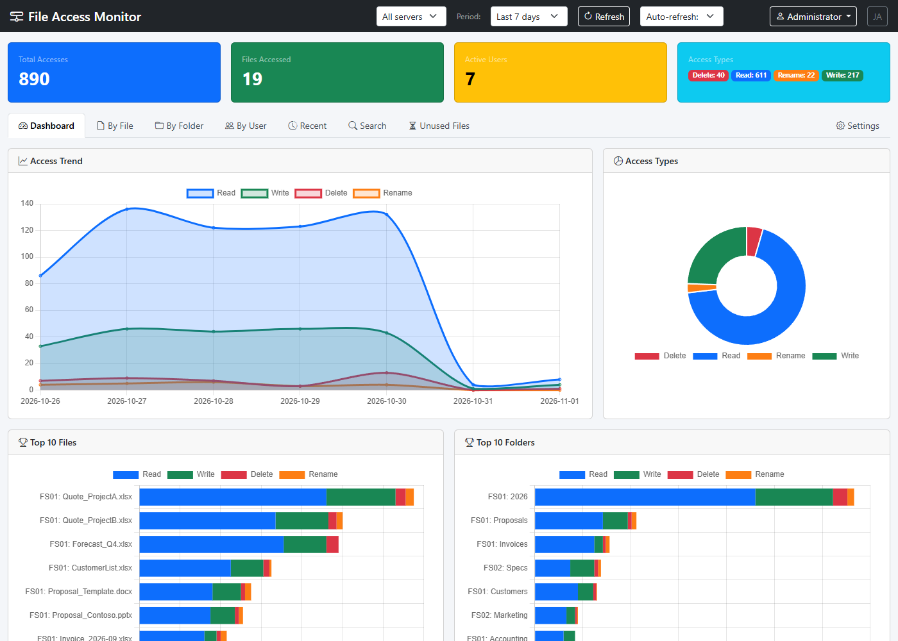

# FileAccessMonitor

English | [日本語](README.ja.md)

FileAccessMonitor records file access (read, write, create, delete, rename, permission changes, and refused attempts) on file servers' shared folders and shows it in a web GUI: from the Windows Security audit log on Windows file servers, and from Samba's audit log on Linux file servers that share folders with Samba. Agents bring the records of several file servers to one monitoring server, which runs on Windows or Linux and stores them in SQLite.



> [!IMPORTANT]
> This tool records who accessed which file and when. If you use it in an organization, tell the people being monitored in advance, in line with your workplace rules and privacy policy.

## Roles and requirements

FileAccessMonitor runs in two roles:

- **Monitoring server**: the web GUI, database, and notifications; it collects and shows the records. It can also record accesses to its own shared folders (**standalone**), or only show what agents send (**monitoring server only**).
- **Agent**: installed on a file server to monitor; it records that server's accesses and sends them to the monitoring server. It has no web GUI.

With one file server, install the monitoring server (standalone) on it and you are done. Install an agent on each further file server.

| | Monitoring server (Windows) | Monitoring server (Linux) | Agent (Windows) | Agent (Linux) |
|---|---|---|---|---|
| OS | Windows Server 2016 or later, Windows 10/11 | x86-64 Linux with systemd (tested on Rocky Linux 9.4) | Windows Server 2016 or later, Windows 10/11 | x86-64 Linux with systemd (tested on Ubuntu 24.04 and Rocky Linux 9.4) |
| Records | When standalone: this server's shared folders on NTFS or ReFS drives (Windows audit log) | With `--collect`: this server's Samba shares | This server's shared folders on NTFS or ReFS drives (Windows audit log) | Samba 4.x shares (access through SMB) |
| Rights | Administrator to install (the web GUI service runs without privileges; with local collection a second service, the collector, runs as SYSTEM) | root to install (the web GUI runs as its own user; with `--collect` a second service, the collector, runs as root) | Administrator to install (runs as SYSTEM) | root |
| Network | Inbound TCP 8080 (web GUI) and 8443 (agents) | Inbound TCP 8080 and 8443 | Outbound to the monitoring server's 8443 only | Outbound to the monitoring server's 8443 only |
| Download | `FileAccessMonitor-Setup-<version>.exe` | `fileaccessmonitor-server` rpm / deb (or tar.gz) | `FileAccessMonitor-Setup-<version>.exe` (choose **Agent**) | `fileaccessmonitor-agent` rpm / deb (or tar.gz) |
| Steps | [Install with the installer](#install-with-the-installer-recommended) | [Monitoring server on Linux](https://github.com/nuts-i77/FileAccessMonitor/blob/main/docs/linux-server.md) | [Collect from several file servers](https://github.com/nuts-i77/FileAccessMonitor/blob/main/docs/agents.md) | [Linux file servers](https://github.com/nuts-i77/FileAccessMonitor/blob/main/docs/agents.md#linux-file-servers-samba-agent) |

- Everything is published self-contained, so no .NET runtime needs to be installed (the .NET 10 SDK is needed only to build from source).
- The web GUI is used from a browser (Edge, Chrome, Firefox, and so on) on any PC that can reach the monitoring server.
- Only agents connect to the monitoring server; the monitoring server never connects to the file servers.

## Setup

### Install with the installer (recommended)

Download `FileAccessMonitor-Setup-<version>.exe` from [Releases](https://github.com/nuts-i77/FileAccessMonitor/releases) and run it on the Windows file server (or on the machine that will be the monitoring server, if that is a separate one). The installer does the following:

- Installs to `C:\Program Files\FileAccessMonitor`
- Registers and starts the Windows services: `FileAccessMonitor` (web GUI and database; runs as the virtual account `NT SERVICE\FileAccessMonitor`, without privileges) and, unless you chose monitoring only, `FileAccessMonitorCollector` ("File Access Monitor Collector"; runs as SYSTEM, records accesses and sets up auditing). An agent install has the one service `FileAccessMonitor` (SYSTEM). See [Which account runs what](https://github.com/nuts-i77/FileAccessMonitor/blob/main/docs/security.md#which-account-runs-what)
- Lets you choose how the server is used: **Standalone / monitoring server** (records accesses on this server and shows the web GUI), **Monitoring server only** (shows the web GUI and receives records from [agents](https://github.com/nuts-i77/FileAccessMonitor/blob/main/docs/agents.md), but does not record or change auditing on this server), or **Agent**
- Lets you choose the web GUI port (default 8080) and, optionally, adds a firewall rule that allows FileAccessMonitor.exe (the web GUI port and the agent port 8443)

When you run a newer installer, it upgrades the existing install and keeps your settings. Then continue with [First sign-in](#first-sign-in).

After the first sign-in the **setup wizard** opens. It changes the admin password, picks the file server (when there are agents), adds the first monitored folder, enlarges the Security log (Windows; 1 GB is recommended) and waits for the first record. **Later** closes it; the **Setup wizard** button on the Settings tab opens it again at any time. The sections below describe what the wizard does.

> [!NOTE]
> The installer is not code-signed, so Windows SmartScreen may show a warning. Choose **More info** → **Run anyway**. To check that the download is genuine, see [Verifying downloads](https://github.com/nuts-i77/FileAccessMonitor/blob/main/docs/install.md#verifying-downloads).

To build from source instead, see [Installation details](https://github.com/nuts-i77/FileAccessMonitor/blob/main/docs/install.md).

### First sign-in

Open `https://<server>:8080` in a browser (a new install uses HTTPS with a self-signed certificate, so the browser warns once; an install upgraded from before 1.9 stays on `http://` until you switch, see [Transport encryption](https://github.com/nuts-i77/FileAccessMonitor/blob/main/docs/security.md)) and sign in with:

- User name: `admin`
- Password: generated at random on first start and saved on the server in this file, which only SYSTEM, Administrators and the web GUI service account can read:

  ```
  C:\ProgramData\FileAccessMonitor\initial-admin-password.txt
  ```

After you sign in, open the user menu (top right) → **Change password** and set your own password. The file is deleted automatically when you change it.

### Add folders to monitor

On the **Settings** tab, add a folder to monitor, for example `D:\Share`. When you add it, the tool does two things automatically:

- Enables the audit policies **File System** (success and failure), **Handle Manipulation** (failure only; without it refused opens are not logged) and **Authorization Policy Change** (success; permission changes)
- Sets audit entries (SACLs) on the folder and everything under it, for successful and refused reads, writes and deletes and for permission and owner changes

After upgrading from before 1.9, press **Re-apply SACL** once for each existing monitored folder (on Linux shares the same button re-applies the Samba auditing): until then refused access and permission changes are not recorded. The Settings page shows which folders still need it.

The **File Share** audit policy, used to find the client IP address, is enabled automatically when the service starts.

To configure auditing with scripts instead, run `setup-audit.ps1 -SharePaths "D:\Share"`. To undo it, run `restore-audit.ps1 -SharePaths "D:\Share"` $1
On Windows, see also [the USN journal](https://github.com/nuts-i77/FileAccessMonitor/blob/main/docs/install.md#create-and-renames-on-windows-usn-journal), which records creations and new names, and [enlarging the Security log](https://github.com/nuts-i77/FileAccessMonitor/blob/main/docs/install.md#enlarge-the-security-log-recommended).

## Documentation

| Topic | Contents |
|---|---|
| [Installation details](https://github.com/nuts-i77/FileAccessMonitor/blob/main/docs/install.md) | Building from source, installing the service by script, the USN journal, the Security log size, verifying downloads, development |
| [Agents](https://github.com/nuts-i77/FileAccessMonitor/blob/main/docs/agents.md) | Collecting from several Windows and Linux (Samba) file servers |
| [Monitoring server on Linux](https://github.com/nuts-i77/FileAccessMonitor/blob/main/docs/linux-server.md) | Running the monitoring server on Linux |
| [Web GUI](https://github.com/nuts-i77/FileAccessMonitor/blob/main/docs/gui.md) | The tabs, notifications, the scheduled report, file history, the permissions report |
| [Security](https://github.com/nuts-i77/FileAccessMonitor/blob/main/docs/security.md) | Sign-in, roles, viewing scopes, the operation log, tamper detection, which account runs what |
| [Configuration](https://github.com/nuts-i77/FileAccessMonitor/blob/main/docs/configuration.md) | appsettings.json, runtime settings and the data folder |
| [How it works](https://github.com/nuts-i77/FileAccessMonitor/blob/main/docs/how-it-works.md) | Collection, access type classification, recording rules, limitations |
| [Comparison with other tools](https://github.com/nuts-i77/FileAccessMonitor/blob/main/docs/comparison.md) | When to choose this tool or another |
| [Backup and restore](https://github.com/nuts-i77/FileAccessMonitor/blob/main/docs/backup.md) | Daily and command-line backups of the data folder, restoring, going back after a failed update |
| [Uninstall](https://github.com/nuts-i77/FileAccessMonitor/blob/main/docs/uninstall.md) | Removing the program and its auditing |
| [HTTPS](https://github.com/nuts-i77/FileAccessMonitor/blob/main/docs/https.md) | HTTPS for the web GUI in detail |
| [Tamper detection](https://github.com/nuts-i77/FileAccessMonitor/blob/main/docs/integrity.md) | How tamper detection works, and how to operate it |

## Limitations

See [Limitations](https://github.com/nuts-i77/FileAccessMonitor/blob/main/docs/how-it-works.md#limitations) in How it works (moved there in 1.13).

## Privacy policy

This program will not transfer any information to other networked systems unless specifically requested by the user or the person installing or operating it. It sends data to other systems only when an administrator configures it to: notifications go to the webhook URLs and mail servers set on the Settings tab, and reverse DNS lookups of client IP addresses go to the DNS servers set there. An agent sends its access records to the monitoring server it was registered with.

Update check: when an Admin opens the web GUI, at most once a day, the Admin's browser asks the GitHub API (`api.github.com`) for the latest release of this project. Like any web request, this reveals the browser's IP address and user agent to GitHub. No data about the file server or its records is sent, and the file server itself does not connect out. Turn it off under **Settings → App and connection**.

## License

[MIT License](LICENSE)

Bundled third-party libraries (`wwwroot/lib/`):

| Library | Version | License |
|---|---|---|
| [Bootstrap](https://getbootstrap.com/) | 5.3.3 | MIT |
| [Bootstrap Icons](https://icons.getbootstrap.com/) | 1.11.3 | MIT |
| [Chart.js](https://www.chartjs.org/) | 4.4.4 | MIT |

Each library's license text is in its folder under `wwwroot/lib/`.
