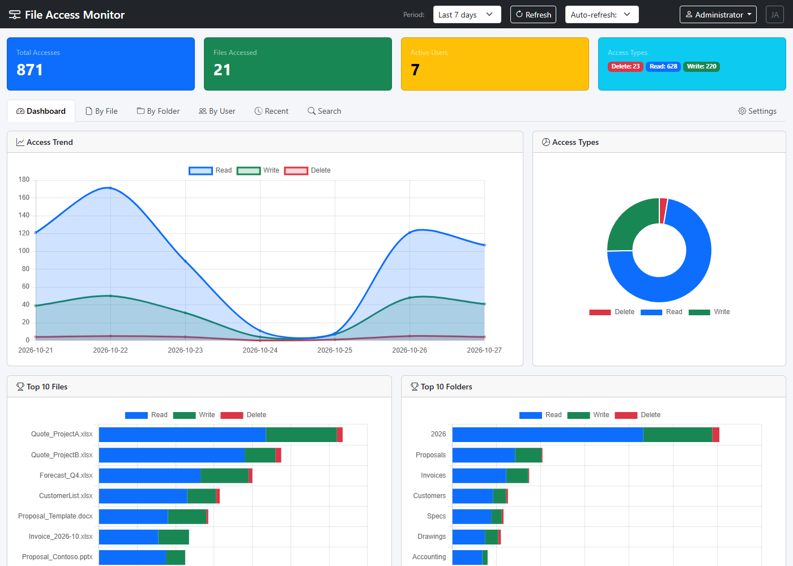
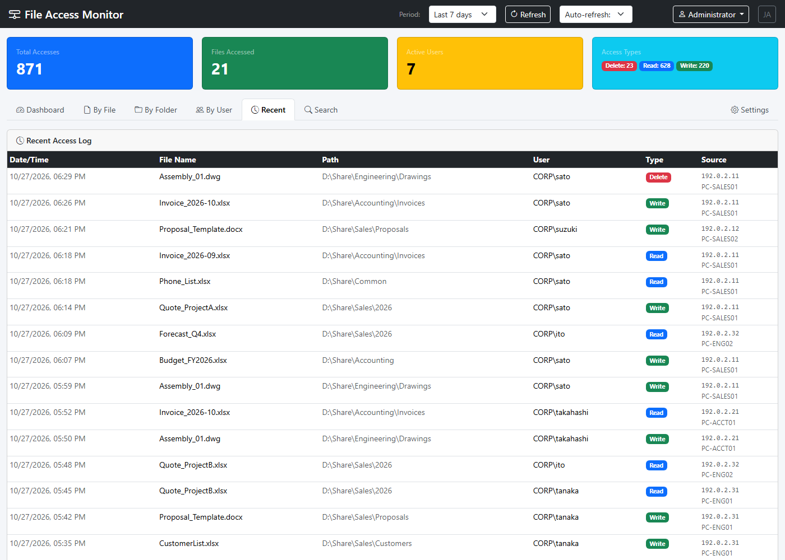
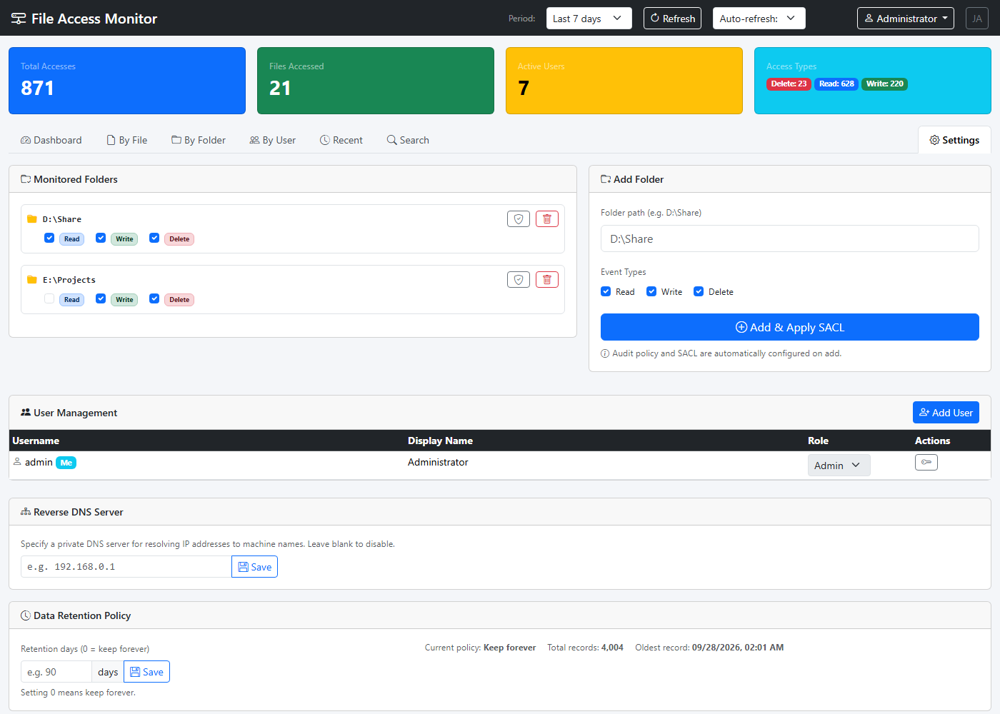

# FileAccessMonitor

English | [日本語](README.ja.md)

FileAccessMonitor collects file access events (read, write, delete) on a Windows file server's shared folders from the Windows Security audit log. It stores them in SQLite and shows them in a web GUI.



> [!IMPORTANT]
> This tool records who accessed which file and when. If you use it in an organization, tell the people being monitored in advance, in line with your workplace rules and privacy policy.

## Requirements

- Windows Server 2016 or later (or Windows 10/11), running on the server that hosts the shared folders
- .NET 10 SDK, needed to build only. The app is published self-contained, so the server does not need the .NET runtime.
- Administrator rights, needed to read the Security log and to set SACLs

## Setup

### Install with the installer (recommended)

Download `FileAccessMonitor-Setup-<version>.exe` from [Releases](https://github.com/nuts-i77/FileAccessMonitor/releases) and run it on the file server. The installer does the following:

- Installs to `C:\Program Files\FileAccessMonitor`
- Registers and starts the `FileAccessMonitor` Windows service
- Lets you choose the web GUI port (default 8080) and, optionally, adds a firewall rule for it

When you run a newer installer, it upgrades the existing install and keeps your settings. Then continue with [3. First sign-in](#3-first-sign-in).

> [!NOTE]
> The installer is not code-signed, so Windows SmartScreen may show a warning. Choose **More info** → **Run anyway**. To verify the download, compare its hash with `SHA256SUMS.txt` on the release page by running `Get-FileHash <file>`.

To build from source instead, follow steps 1 and 2.

### 1. Build (on your development PC)

```powershell
.\build.ps1
```

A self-contained EXE is written to `publish\`.

### 2. Install the service (on the server, in an elevated PowerShell)

Copy `publish\` and `install-service.ps1` to the server, then run:

```powershell
.\install-service.ps1
```

This does two things:

- Registers and starts a Windows service named `FileAccessMonitor`, with automatic startup
- Adds a Windows Firewall inbound rule for TCP 8080

If WinRM is available, you can build and deploy from your development PC in one step:

```powershell
.\deploy-remote.ps1 -ServerIP <server name or IP>
```

### 3. First sign-in

Open `http://<server>:8080` in a browser and sign in with:

- User name: `admin`
- Password: generated at random on first start and saved on the server in this file, which only SYSTEM and Administrators can read:

  ```
  C:\ProgramData\FileAccessMonitor\initial-admin-password.txt
  ```

After you sign in, open the user menu (top right) → **Change password** and set your own password. The file is deleted automatically when you change it.

### 4. Add folders to monitor

On the **Settings** tab, add a folder to monitor, for example `D:\Share`. When you add it, the tool does two things automatically:

- Enables the **File System** audit policy
- Sets audit entries (SACLs) on the folder and everything under it

The **File Share** audit policy, used to find the client IP address, is enabled automatically when the service starts.

To configure auditing with scripts instead, run `setup-audit.ps1 -SharePaths "D:\Share"`. To undo it, run `restore-audit.ps1 -SharePaths "D:\Share"`.

### 5. Enlarge the Security log (recommended)

By default the Windows Security log holds only about 20 MB. On a busy server, older events are overwritten within hours. FileAccessMonitor collects events in real time, so its own records are not lost. A larger log still lets you check the original events later.

```powershell
wevtutil sl Security /ms:1073741824   # 1 GB
```

## Security

- **JWT signing key**: generated at random on first start and saved to `C:\ProgramData\FileAccessMonitor\jwt.key`, which only SYSTEM and Administrators can read. If you set a `Jwt:Key` of 32 bytes or more in `appsettings.json`, that key is used instead.
- **Sign-in lockout**: after 5 failed sign-ins in a row, the account is locked for 15 minutes.
- **Sign-in sessions**: a sign-in stays valid for `Jwt:ExpiresHours` (default 24 hours), but ends immediately when the user is deleted, their role changes, or their password is changed or reset.
- **Operation log**: sign-ins (including failures), user management, setting changes, CSV exports, and notifications sent are recorded and shown under **Settings → Operation Log** (Admin only).
- **Notification secrets**: the webhook URL and SMTP password are stored encrypted (ASP.NET Core Data Protection with machine DPAPI; keys in `C:\ProgramData\FileAccessMonitor\keys\`).
- **Transport encryption**: the default is plain HTTP. To use HTTPS, either add an HTTPS endpoint and certificate under `Kestrel.Endpoints`, or put the app behind a reverse proxy such as IIS, nginx, or Caddy. See [docs/https.md](docs/https.md) for sample configurations. Do this if the GUI is reachable from outside your LAN, or if passwords must not travel in clear text.
- **Roles**: `Admin` can change settings and manage users. `Viewer` can only view.

To report a vulnerability, please follow [SECURITY.md](SECURITY.md) instead of opening a public issue.

## Configuration

### appsettings.json (in `publish\`)

| Setting | Description | Default |
|---|---|---|
| `Kestrel.Endpoints.Http.Url` | Listen URL | `http://0.0.0.0:8080` |
| `Jwt:ExpiresHours` | How long a sign-in stays valid, in hours | `24` |
| `Jwt:Key` | JWT signing key (usually not needed; see above) | Auto-generated |
| `ExcludeSystemAccounts` | Ignore access by SYSTEM and computer accounts (`xxx$`) | `true` |
| `ExcludeProcessNames` | Process names to ignore | `System`, `svchost.exe`, `SearchIndexer.exe` |

With the installer, `appsettings.json` is in `C:\Program Files\FileAccessMonitor\` and is replaced on upgrade. Put your own changes in `appsettings.Production.json` in the same folder instead. The installer creates that file with the port you chose, and your changes to it are kept on upgrade.

### Runtime settings and data (`C:\ProgramData\FileAccessMonitor\`)

| File | Contents |
|---|---|
| `settings.json` | Monitored folders, recorded access types, reverse-DNS server, retention, notifications (edited from the GUI) |
| `fileaccess.db` | Access records (SQLite) |
| `logs\app-YYYYMMDD.log` | Application log (kept for 14 days) |
| `jwt.key` | JWT signing key |

## Web GUI

| Tab | Contents |
|---|---|
| Dashboard | Access trend chart, breakdown by type, top files and folders |
| Files / Folders / Users | Rankings with detail dialogs |
| Recent | Access log with client IP and machine name |
| Search | Search by keyword, period, type, or IP; export the results as CSV (up to 200,000 rows, opens in Excel) |
| Settings | Monitored folders, users, reverse DNS, data retention, notifications, operation log |

The GUI is available in English and Japanese. Switch languages at the top right; on first visit the GUI follows the browser's language. Messages returned by the API use the selected language too.

**Recent access log** — who opened which file, from which IP address and machine:



**Settings** — monitored folders and recorded access types, users, reverse DNS, and data retention:



The screenshots use fictional sample data.

## How it works

1. Subscribes to the Windows Security event log in real time (events 4663 and 4659).
2. Finds the client IP address and machine name from logon (4624) and share access (5140) events and from the list of SMB sessions.
3. Stores records in SQLite and aggregates them through an ASP.NET Core web API.
4. Displays them in the browser with Bootstrap and Chart.js.

### Access type classification (AccessMask)

| Type | Mask |
|---|---|
| Read | `0x1` (ReadData) / `0x80000000` (GENERIC_READ) |
| Write | `0x2` (WriteData) / `0x4` (AppendData) / `0x40000000` (GENERIC_WRITE) |
| Delete | `0x10000` (DELETE), and event 4659 |

## Limitations

- **Operations that do not open a file are not recorded.** This includes reading only attributes or timestamps (`0x80` ReadAttributes and similar) and listing folders. For example, when an incremental backup tool finds a file unchanged and skips copying it, that file is not recorded.
- Events that occur while the service is stopped (for example during an upgrade or reboot) are collected when it starts again, as long as they are still in the Security log. If the log has already overwritten them, the gap is recorded in the operation log.
- The service must run on the file server it monitors. It cannot monitor remote servers.
- Times are stored in UTC. The GUI shows them, and groups them by day, in the browser's time zone.

## Development

```powershell
dotnet build FileAccessMonitor.csproj
dotnet test tests/FileAccessMonitor.Tests
```

To build the installer locally, install [Inno Setup 6](https://jrsoftware.org/isinfo.php) and run `.\build-installer.ps1 -Version 1.0.0`. The output goes to `dist\`.

GitHub Actions (`.github/workflows/ci.yml`) builds, tests, and publishes the app on every push and pull request. Pushing a tag such as `v1.0.0` runs `.github/workflows/release.yml`, which builds the installer and a portable zip and publishes them as a GitHub Release.

## Uninstall

If you used the installer, uninstall **File Access Monitor** from **Settings → Apps**. The service and firewall rule are removed. Access records, settings, and keys stay in `C:\ProgramData\FileAccessMonitor\`; delete that folder if you no longer need them. To remove the audit entries (SACLs), run `C:\Program Files\FileAccessMonitor\scripts\restore-audit.ps1` before uninstalling.

If you installed from source:

```powershell
.\install-service.ps1 -Uninstall
.\restore-audit.ps1 -SharePaths "D:\Share"   # to remove the audit settings as well
```

## License

[MIT License](LICENSE)

Bundled third-party libraries (`wwwroot/lib/`):

| Library | Version | License |
|---|---|---|
| [Bootstrap](https://getbootstrap.com/) | 5.3.3 | MIT |
| [Bootstrap Icons](https://icons.getbootstrap.com/) | 1.11.3 | MIT |
| [Chart.js](https://www.chartjs.org/) | 4.4.4 | MIT |

Each library's license text is in its folder under `wwwroot/lib/`.
