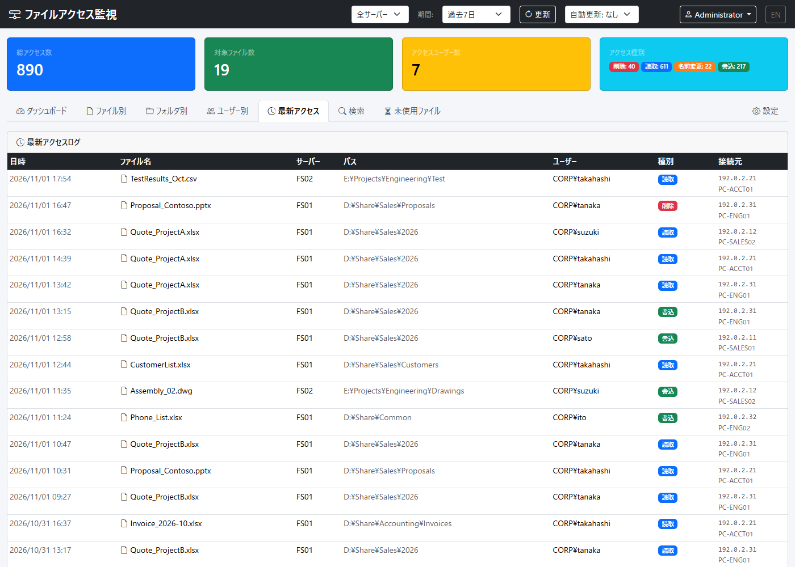
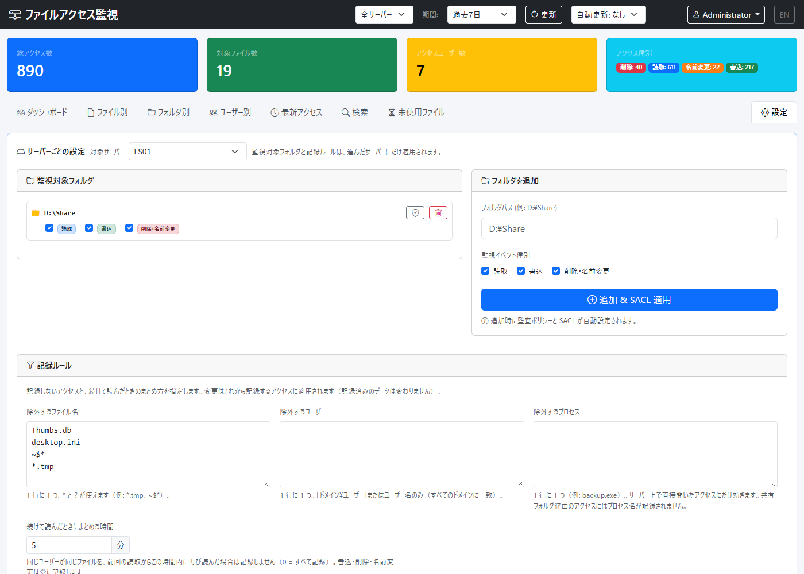

# Web GUI

[English](gui.md) | 日本語

| タブ | 内容 |
|---|---|
| ダッシュボード | アクセス推移グラフ、種別内訳、拒否された試みの件数、上位ファイル／フォルダ。グラフの値をクリックすると、該当する記録（［検索］タブ）またはファイル・フォルダの詳細を表示します |
| 集計 | ファイル別・フォルダ別・ユーザー別のランキング（上部のボタンで切り替え）と詳細ダイアログ |
| 最新アクセス | アクセスログ（接続元 IP・端末名付き）。拒否された試みは赤い **拒否** の印が付き、「結果」の絞り込みで表示・非表示を切り替えられます。名前変更は移動先も表示し、権限変更は内容を見る情報ボタンがあります。ファイル名の横の時計のボタンで、そのファイルの履歴を表示します |
| 検索 | キーワード・期間・種別・IP による横断検索。結果を CSV で出力（最大 20 万件、Excel で開けます） |
| 未使用ファイル | 監視フォルダ内で、指定期間に読まれていない（アクセスのない）ファイルとその容量を、フォルダを調べて一覧・フォルダ別に集計（Admin のみ、1 回あたり最大 10 万ファイル） |
| アクセス権 | 監視フォルダとその配下の、最後のスキャン時点での権限。単に継承しているだけでない項目、広いアクセス（Everyone、Authenticated Users など）、継承を切っているフォルダを表示します。スキャンは管理者だけが開始できます。フォルダの閲覧範囲を持つ Viewer は、自分のフォルダについて保存済みの結果を見られます |
| 設定 | 左のメニューで選んだ項目を 1 ページずつ表示します。サーバーごと: 監視フォルダ、記録ルール（除外・連続した読み取りのまとめ）、Security ログのサイズ。全体: エージェント、通知、定期レポート、改ざん検知、ユーザー、データ保持と逆引き DNS、バックアップ、アプリと HTTPS の接続、操作ログ。長い説明は **詳しく** で開きます |

通知（Teams / Slack / Webhook / メール）は、1 人のユーザーが数分以内に設定件数以上のファイルを削除・書き込み・読み取りしたとき（大量読み取りは既定でオフ）、1 人のユーザーが設定回数以上アクセスを拒否されたとき（**拒否の連続**。既定は 5 分で 20 回）、ランサムウェアに似た動きがあったとき（**緊急**。下記）と、記録が途切れたとき（Security ログのイベントが収集前に上書きされた、またはログが消去された。消去したユーザーも通知。Linux のサーバーでは journald が監査ログを捨てた、またはジャーナルに残っていなかった）に送信します。連絡が途絶えたエージェントも通知します。インターネットへの接続にプロキシが必要な場合は、通知設定でプロキシを指定してください（Webhook のみ。サービスはサービスアカウントで動くため、ログオンしているユーザーの Windows のプロキシ設定は使われません）。

Webhook の宛先には、このマシン自身（localhost、`127.x.x.x`、`::1`）、リンクローカルアドレス（クラウドのメタデータ用アドレスを含む `169.254.x.x` と `fe80::`）、未指定アドレス、マルチキャストアドレスは指定できません。URL の保存時と、接続時の両方で確認するため、名前解決の結果がこれらのアドレスになる場合も拒否されます。リダイレクトには従いません。ネットワーク内のチャットサーバー向けに、プライベートアドレス（`10.x`、`172.16-31.x`、`192.168.x`）は使用できます。

**ランサムウェアに似た動き** は、ユーザーごとに 2 分間の操作を 3 つのルールで見ます。同じ新しい拡張子（`.tmp` のような無害なものを除く）への 20 ファイル以上の名前変更（新しいパスが必要なので、Windows では USN ジャーナルが必要）、100 回以上の書き込みと 50 回以上の名前変更が重なったとき、身代金要求文のようなファイル名（`README_DECRYPT.txt`、`HOW_TO_RECOVER_FILES.html` など）が 3 つ以上のフォルダに作られたときです。この通知は優先度を高くして送り（「【緊急】」の印。メールは重要度高）、該当したルールとファイルを示します。自動で何かを止めたり切断したりはしません。既定でオンで、通知設定でオフにできます。数値は `settings.json` の `Alerts` にあります。通知は、他の通知と同じく有効にしたときだけ送ります。

**ファイルの履歴。** ファイル名の横の時計のボタン（最新アクセス、検索結果、ファイル別の一覧、ファイルとフォルダの詳細ダイアログ）を押すと、そのファイルやフォルダの履歴を表示します。今の場所に至るまでと、その後の出来事を、名前変更と移動をたどって示します。フォルダの名前変更と移動もたどりますが、名前変更は「削除」の種類と一緒に記録されるため、そのフォルダで **削除** を監視している必要があります。閲覧範囲の外の手順は隠し、「閲覧範囲の外」の区切りとして表示します。CSV で出力できます。

**アクセス権のレポート。** **アクセス権** タブで、監視フォルダとその配下について、最後のスキャン時点の権限を表示します。単に継承しているだけでない項目、広いアクセス（SID で判定するため、Windows の表示言語に関係ありません）、継承を切っているフォルダを示します。スキャンは管理者が **今すぐスキャン** で開始します。Linux では POSIX の権限と Samba の共有の設定（`guest ok`、`read only`、`valid users`、`write list`）も表示します。`acl_xattr` または `acl_tdb` を使う共有の NT ACL は読まず、その旨を警告します。既定ではフォルダだけを調べます（ファイルは通常フォルダの権限を引き継ぐため）。ファイルも調べるときは **フォルダのみ** のチェックを外します。スキャンには上限があり（既定は 5,000 フォルダ、50,000 ファイル、結果は 20,000 行まで）、上限で止まった場合はその旨を表示します。その場合は、各フォルダの横のボタンでサブフォルダをスキャンするか、［対象フォルダ］に監視フォルダの下のフォルダを入力して［今すぐスキャン］を押します。［対象フォルダ］の右のボタンで、監視フォルダとサブフォルダのスキャン結果を選べます。管理者は［削除］でサブフォルダのスキャン結果を削除できます。権限のジョブには 1.10 以降のエージェントが必要です。

**定期レポートのメール。** 既定ではオフです。**設定 → 定期レポート** のカードで、毎日・毎週・毎月、サーバーのローカル時刻にメールで概要を送ります。アクセス、拒否された試み、権限変更、よく使われたファイル・フォルダ・ユーザー、保存済みの最新スキャンによる広いアクセスを含みます（レポートはスキャンを開始しません）。管理者には、さらにアラート、エージェントの状態、改ざん検知の状態も届きます。CSV の添付は任意です。通知先メールアドレスを持つ Viewer には、そのフォルダだけを対象にしたレポートが届きます（閲覧範囲の画面で「定期レポート（範囲内のみ）もこのアドレスに送る」を外すと届きません）。先に メールを設定してください。**テストレポートを今すぐ送る** は、スケジュールを変えずに送って確認できます。

**改ざん検知。** 新しいアクセス記録と操作ログの各行は、直前の行と鍵付きのハッシュ（HMAC）でつながります。このプログラム以外で行われた変更、削除、追加、順序の入れ替えは、15 分ごとの検証（毎晩は全件）で見つかり、緊急の通知を送ります。設定の **改ざん検知** のカードで状態を確認し、今すぐ検証、署名付きのアンカーのダウンロード、確認後の承認ができます。毎日、チェーンの末尾を Windows のイベントログ（ソース `FileAccessMonitor`、イベント 1100）または syslog（タグ `fileaccessmonitor`）に書き込み、定期レポートにも含めます。鍵はデータフォルダの `chain.key` で、データベースと一緒にバックアップしてください。1.10 より前に保存された記録は保護されません。仕組みと運用の詳細は [改ざん検知の仕組み](integrity.ja.md) を参照してください。

日本語 / 英語に対応しています（画面右上で切り替え。初回はブラウザの言語設定に従います）。API が返すエラーメッセージも選択中の言語になります。

**最新アクセス** — 誰が・どのファイルサーバーで・どの端末（IP アドレス）から・どのファイルにアクセスしたか:

**設定** — サーバーごとの監視フォルダと記録ルール（画像はエージェント FS01 を選択した状態）と、全体の設定:

スクリーンショットは架空のサンプルデータです。
