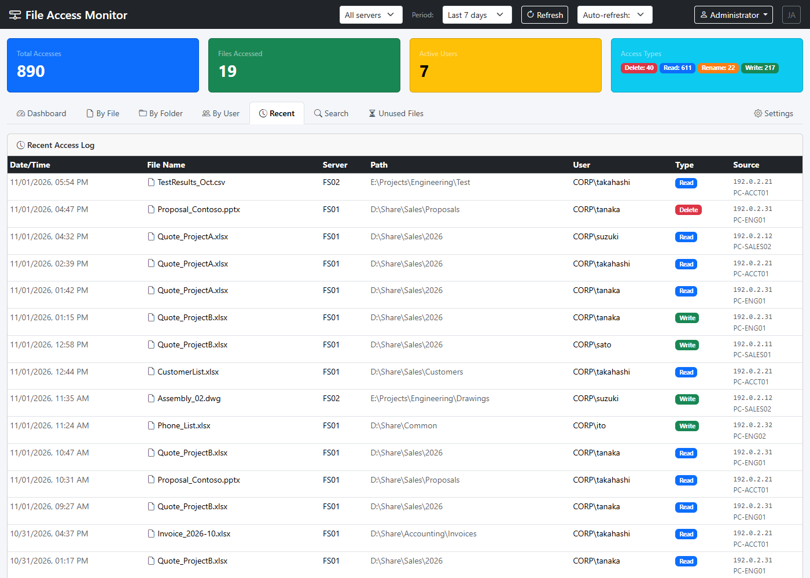
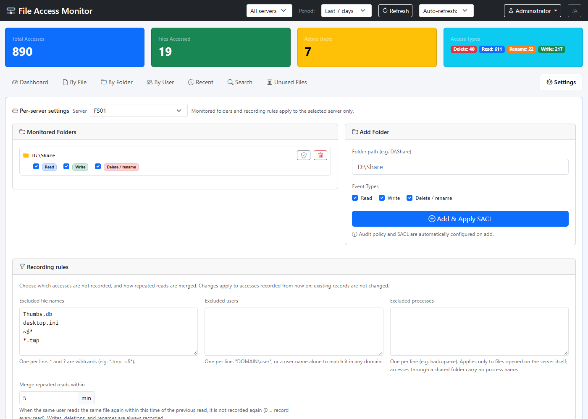

# Web GUI

English | [日本語](gui.ja.md)

| Tab | Contents |
|---|---|
| Dashboard | Access trend chart, breakdown by type, a count of refused attempts, top files and folders. Click a value in a chart to open its records in Search, or the file or folder detail |
| Totals | Rankings by file, folder or user (buttons at the top switch between them) with detail dialogs |
| Recent | Access log with client IP and machine name. Refused attempts have a red **Denied** mark and can be shown or hidden with the Result filter; a renamed file shows its new path; permission changes have an info button with what changed. Each file name has a clock button that opens its history (see below) |
| Search | Search by keyword, period, type, or IP; export the results as CSV (up to 200,000 rows, opens in Excel) |
| Unused Files | Files in a monitored folder that nobody read (or accessed) in a period, found by scanning the folder, with their size totaled per subfolder (Admin only; up to 100,000 files per scan) |
| Permissions | Who may do what in a monitored folder as of the last scan: entries that are not simply inherited, broad access (Everyone, Authenticated Users, ...) and folders that do not inherit. Scans are started by Admins only; a Viewer with a folder scope sees the stored result for their folders |
| Settings | A menu on the left opens one page at a time. Per server: monitored folders, recording rules (exclusions and merging of repeated reads), Security log size. For all servers: agents, notifications, scheduled report, tamper detection, users, data retention and reverse DNS, backup, app and HTTPS connection, operation log. Long explanations open with **Details** |

Notifications (Teams, Slack, a webhook, or email) are sent when one user deletes, writes, or reads at least a set number of files within a few minutes (mass reads are off by default), when one user is refused access at least a set number of times (**denied burst**, 20 in 5 minutes by default), when a user's activity looks like ransomware (**high priority**, see below), and when recording was interrupted: Security log events were overwritten before they were collected, or the log was cleared (with the user who cleared it); on Linux servers, journald dropped audit lines or the journal no longer had them. Agents that stop reporting are notified too. If the internet is reached through a proxy, set it in the notification settings (webhooks only; the service runs as a service account, so a signed-in user's Windows proxy setting does not apply).

The webhook cannot point to this machine (localhost, `127.x.x.x`, `::1`), to link-local addresses (`169.254.x.x`, which includes the cloud metadata address, and `fe80::`), or to unspecified or multicast addresses; this is checked when the URL is saved and again when the connection is made (so a name that resolves to such an address is refused too), and redirects are not followed. Private addresses (`10.x`, `172.16-31.x`, `192.168.x`) are allowed, for chat servers inside the network.

**Ransomware-like behaviour** is checked per user over 2 minutes, by three rules: at least 20 files renamed to the same new extension (not a harmless one such as `.tmp`; needs the new path, so on Windows the USN journal), at least 100 writes together with at least 50 renames, and a ransom-note file name (`README_DECRYPT.txt`, `HOW_TO_RECOVER_FILES.html` and similar) created in at least 3 folders. Such an alert is sent with high priority (a "[HIGH PRIORITY]" mark; high importance for mail) and names the rule and the files. Nothing is blocked or disconnected automatically. It is on by default and can be turned off in the alert settings; the numbers are in `settings.json` under `Alerts`. Alerts must be turned on, as for the other alerts.

**File history.** The clock button next to a file name (in the Recent log, in search results, in the By File table, and in the file and folder detail dialogs) opens the history of that file or folder: how it came to be where it is, and what happened to it since, following renames and moves. Folder renames and moves are followed too, but a rename is recorded together with the Delete access type, so Delete must be monitored for that folder. Viewers see only the steps inside their folders; other steps are shown as a gap. The history can be exported as CSV.

**Permissions report.** The **Permissions** tab shows the permissions of a monitored folder and below it as of the last scan: entries that are not simply inherited, broad access (recognized by SID, so it works in any Windows language) and folders that do not inherit their permissions. Admins start a scan with **Scan now**. On Linux the report also shows the POSIX permissions and the Samba share settings (`guest ok`, `read only`, `valid users`, `write list`). NT ACLs of shares that use `acl_xattr` or `acl_tdb` are not read, and the report warns about them. A scan reads folders only by default (files nearly always inherit their folder's permissions); untick **Folders only** to look at files too. A scan stops at its limits (5,000 folders and 50,000 files by default; 20,000 rows in the result) and says which one; scan a subfolder with the button next to it, or type a folder below the monitored one in **Folder** and select **Scan now**. The button next to **Folder** lists the monitored folders and the subfolder scans. An Admin can delete a subfolder scan result with **Delete**. The permissions job needs agents of version 1.10 or later.

**Scheduled report e-mail.** Off by default. Under **Settings → Scheduled report**, the card sends a summary by e-mail daily, weekly or monthly, at the server's local time. It covers accesses, refused attempts, permission changes, the top files, folders and users, and the broad permissions of the last stored scans (the report never starts a scan). Admins also get alerts, the agents' state and the tamper-detection state. CSV attachments are optional. Each Viewer with a notification address gets a report limited to their folders, unless the **Also send the scheduled report** box in their scope dialog is unticked. E-mail must be set up first. **Send a test report now** sends one without changing the schedule.

**Tamper detection.** Each new access record and operation-log entry is chained to the one before it with a keyed hash. Records that are changed, deleted, added or reordered outside the program are found by verification (every 15 minutes, and in full every night) and raise a high-priority alert. The **Tamper detection** card in Settings shows the state, lets you verify now, download a signed anchor and accept a finding after checking it. Every day the end of each chain is written to the Windows event log (source `FileAccessMonitor`, event 1100) or to syslog (tag `fileaccessmonitor`), and it is included in the scheduled report. The key is `chain.key` in the data folder: back it up with the database. Records saved before 1.10 are not protected. See [How tamper detection works](integrity.md) for the details and operation.

The GUI is available in English and Japanese. Switch languages at the top right; on first visit the GUI follows the browser's language. Messages returned by the API use the selected language too.

**Recent access log** — who opened which file, on which file server, from which IP address and machine:

**Settings** — per-server monitored folders and recording rules (here for the agent FS01), then the settings for all servers:

The screenshots use fictional sample data.
